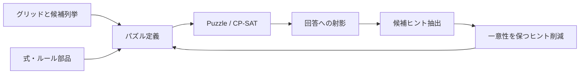

# ルール・回答・ヒントを接続する設計

パズルを合成するときは、使うルールだけでなく、盤面の座標、変数の役割、
何を同じ回答とするか、どの情報をヒントとして削除できるかを揃えます。
`Puzzle` と制約が求解を、固定された設定を持つレシピが生成を受け持ちます。

## 実装の境界

| 層 | 入口 | 責務 |
| --- | --- | --- |
| 空間 | [grid.py](../packages/puzzle/src/puzzle/grid.py) | `Cell` / `Edge` / `Vertex`、隣接、窓、ブロック |
| 式 | [expr.py](../packages/puzzle/src/puzzle/expr.py) | 値と条件、条件の真偽を表す式 |
| 部品 | [constraints.py](../packages/puzzle/src/puzzle/constraints.py)、[match.py](../packages/puzzle/src/puzzle/match.py) | 個数、全異、連結、単一ループ、対応付け |
| コンパイルと求解 | [puzzle.py](../packages/puzzle/src/puzzle/puzzle.py) | CP-SATモデル、補助変数、回答の一意性 |
| 候補の事前計算 | [regions.py](../packages/puzzle-defs/src/puzzle_defs/regions.py)、[polyomino.py](../packages/puzzle-defs/src/puzzle_defs/polyomino.py) | 領域・ピース配置の列挙と絞り込み |
| 問題とレシピ | [puzzles](../packages/puzzle-defs/src/puzzle_defs/puzzles) | 基礎ルール、ヒントの再適用、回答の取り出し |
| 関数API | [solvers](../packages/solvers/src/solvers) | 定義の作成、`solve`、`result` |
| 作問 | [generator](../packages/generator/src/generator/__init__.py) | 完成解、候補ヒント、初期一意性、削減 |

`Feature` は文字列集合による前提条件チェックです。例えば形状比較は
`region_partition` と `shape_class` を要求しますが、グリッドの一致や領域分割の正しさを証明する型システムではありません。
`bool_var_map` がキーの意味にかかわらず `edge_vars` を登録するような粗い分類もあります。
[モデル所属](model-ownership.md)の検証は、これとは別に変数・式の所有モデルを確認します。

## 回答空間を明示する

| 定義 | 回答として区別するもの | 生成への入口 |
| --- | --- | --- |
| 数独 | 各マスの数字 | `SudokuPuzzle`、9×9固定 |
| 黒白合成 | 各マスの黒白 | `ShadingRecipe` |
| Slitherlink | 使用する辺の集合 | 既存定義と `SlitherlinkRecipe` |
| ヤジリン | 黒セルと使用辺の両方 | `YajilinRecipe` |
| ぬりかべ | 海・各島の所有者 | 専用生成レシピなし |
| ひとりにしてくれ | 黒セル | 専用生成レシピなし |
| Tents | テント配置 | 専用生成レシピなし |
| 四角に切れ | 選択した長方形 | 専用生成レシピなし |
| タイリング | 選択したピース配置 | 専用生成レシピなし |

連結性を示す木、ループの方向、Tentsの木とテントの対応付けは、盤面を支える補助情報です。
同じ可視回答の異なる補助代入を別解と数えないよう、必要に応じて `set_solution_vars` で回答を指定します。
汎用のマッチング問題では対応付け自体が答えなので、一律に除外しません。
ヤジリンの元のセル表示だけでは辺の違いを表せないため、生成レシピは両者を保存・検証します。
詳しくは[回答の射影と一意性](solver-semantics.md)を参照してください。

## 固定するものと削減するもの

レシピは寸法・基礎ルール・固定パラメータ・回答の意味を保ち、`build_from_clues` で
ヒントだけを再適用します。ヒント削除が制約を緩めるという単調性が、既約性の根拠です。
構造を変える情報は削減候補と分けます。例えばヤジリンの矢印マスは数字を消しても障害物として残します。
ぬりかべの島の位置やTentsの木なども、単なる数字ヒントと同じ扱いにはできません。

`connected` は空の対象、`single_cycle` は空の辺集合を許します。
非空がパズルのルールなら、レシピが作るすべての基礎モデルへ `at_least_one(...)` 等を追加します。
生成器だけで非空条件を補うと、ヒント削減時に別の問題を検証することになります。

初期候補ヒントは、基礎ルールの下で一意な回答を定める必要があります。
全数字を与えても一意とは限らず、[Slitherlink](slitherlink-composition.md)と[行列黒数](mixed-shading-clues.md)には具体的な反例があります。
生成契約と失敗の種類は[生成レシピ](generation.md)にまとめています。

## 異なる空間をつなぐ

黒白セルの非接触ルールを辺マップへ渡すだけでは、同じ意味になりません。
Slitherlinkの辺はセルの外周、ヤジリンの辺はセル中心同士を結ぶ辺です。
ヤジリンでは普通セルごとに `degree + 2 * black == 2` を課し、黒なら次数0、白なら次数2に接続します。
矢印セルの役割・ヒント型・回答の射影も合わせて定義します。

共通するのは求解基盤と3操作の生成契約です。任意のルール名を並べて互換性を自動判定する機構ではありません。
拡張するレシピには、必要な空間・変数、追加する制約、固定パラメータ、回答に含む情報、抽出するヒントを明示してください。
ファイル入力は既知の型とパラメータを扱うデータ形式に限定し、任意Python式を読み込んで実行しません。

## 検証と保証の限界

小盤面では、座標・集合・次数などを直接調べる独立の全列挙器と、DSLが返す全回答を照合します。
ルールの意味を変えたときは、双方の実装と反例を確認する必要があります。
ヒント削減後の一意性・各ヒントの必要性と、全候補ヒントでのルールの冗長性も別の性質です。

`solve()` の戻り値が `None` であることだけでは、解なし・複数解・一意性未証明を区別できません。
一意性の検査では別解の不在を証明できたときだけ成功します。未知を一意や不成立と決め付けません。
領域・配置の列挙は大盤面で組合せ爆発し得て、CLIのサイズ制限も時間上限ではありません。

回答変数の選択は座標付きの値を比較します。島番号や同形ピース名の対称性を自動で正規化する機構ではありません。
生成が保証するのは固定ルールの下での一意性と1ヒント削除に対する既約性です。
最少ヒント数、人間の解き筋・難易度、均一な生成分布、任意のルール間の互換性は保証しません。
