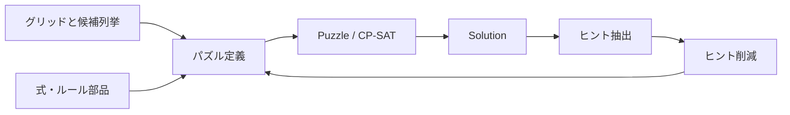

# Puzzle Box の現在地と次の開発

調査基準は `main` の `c4164c2`（generic generator 追加時点）です。
その時点の実装・全108テストと、今回追加した反例に基づいて整理しています。
修正は draft PR で提案しており、本文の「修正」は main への反映済みを意味しません。

## このプロジェクトの核

すでに、パズルを「マスの値」「辺の選択」「領域の選択」「対応付け」に分け、
それぞれへ小さな制約を足していく仕組みがあります。
数独からヤジリンまで同じ DSL で記述できる点が、今後の組み合わせ生成の土台です。

次に価値が大きいのは、パズルの種類を一気に増やすことよりも、
**組み合わせたルールの意味を検証できること**と、
**ヒントを減らしても同じ種類の問題を作り続けること**です。
今回の不具合はテスト数の不足だけでなく、「何を同じ解とするか」や
「入力の矛盾はどの層が責任を持つか」という境界の曖昧さから生じていました。

## 実装を読む順番

| 層 | 読むファイル | 境界と役割 |
| --- | --- | --- |
| 空間 | [grid.py](../packages/puzzle/src/puzzle/grid.py) | Cell / Edge / Vertex、隣接、窓、ブロック |
| 式 | [expr.py](../packages/puzzle/src/puzzle/expr.py) | 値と条件、BoolExpr による真偽の0/1化 |
| 部品 | [constraints.py](../packages/puzzle/src/puzzle/constraints.py)、[match.py](../packages/puzzle/src/puzzle/match.py) | 個数、全異、連結、単一ループ、対応付け |
| コンパイル・求解 | [puzzle.py](../packages/puzzle/src/puzzle/puzzle.py) | CP-SAT のモデルと補助変数を作り、解く |
| 候補の事前計算 | [regions.py](../packages/puzzle-defs/src/puzzle_defs/regions.py)、[polyomino.py](../packages/puzzle-defs/src/puzzle_defs/polyomino.py) | 領域やピース配置の列挙・フィルタリング |
| 問題の定義 | [puzzles](../packages/puzzle-defs/src/puzzle_defs/puzzles) | 8種類のルール構成と結果の取り出し |
| 入口 | [solvers](../packages/solvers/src/solvers) | 定義の作成 → solve → result をつなぐ薄い関数 |
| 作問 | [generator](../packages/generator/src/generator/__init__.py) | 完成解 → ヒント → 一意性を保つ削減 |

`Feature` は現在、文字列の集合による前提条件チェックです。
例えば形状比較は `region_partition` と `shape_class` を要求します。
ただし、グリッドの一致や変数の所有モデル、領域分割の正しさまで証明する型システムではありません。
`bool_var_map` がキーにかかわらず `edge_vars` を登録するなど、粗い分類もあります。

## 現在表せるもの

| パズル | 回答に相当する変数 | 再利用できる部品 | 生成アダプタ |
| --- | --- | --- | --- |
| 数独 | 各マスの数字 | 全異制約・行列・ブロック | あり、9×9固定 |
| Slitherlink | 使用する辺 | 周囲の辺数・次数・ループ | あり、既定5×5 |
| ぬりかべ | 海/各島の所有者 | サイズ・連結・2×2禁止 | なし |
| ひとりにしてくれ | 黒マス | 重複排除・非隣接・白の連結 | なし |
| Tents | テント配置 | 二部マッチング・非接触・行列個数 | なし |
| 四角に切れ | 選択した長方形 | 候補列挙・exact cover | なし |
| タイリング | 選択したピース配置 | exact cover・形状関係・交差禁止 | なし |
| ヤジリン | 黒マスとループの辺 | 矢印個数・非隣接・ループ | なし |

「解ける」ことと「生成できる」ことは別です。現時点で一般生成器の3操作を持つ
既存定義は数独と Slitherlink だけです。Slitherlink の全ヒントが常に一意とも限りません。
ヤジリンの `result()` はセル状態だけを返しますが、別のループ経路も回答として区別する必要があります。

## 実際に再現した問題と対応

| 優先度 | 反例・影響 | 対応 |
| --- | --- | --- |
| 最優先 | `SlitherlinkPuzzle([[4]])` が一意性指定で失敗。連結領域も補助的な木の違いを数える | [PR #2](https://github.com/airtoxin/puzzle-box/pull/2): 回答変数への射影で別解を検査 |
| 最優先 | 配置が固定された3×3 Tentsでも対応付けが2通りある | PR #2: Tents はテント配置だけを回答として指定 |
| 最優先 | `one_of(x >= 0, x <= 2)` が `x=1` を受理 | PR #2: 線形条件にも双方向の対応を付ける |
| 高 | ぬりかべ `[[1, 1]]` が成立する | [PR #3](https://github.com/airtoxin/puzzle-box/pull/3): 別の島の辺接触を禁止 |
| 高 | 候補のない四角に切れ/タイリング、範囲の空なヤジリンで `solve()` が成功する | PR #3: 矛盾をモデルに反映 |
| 高 | Tents の木だけの行列で個数条件が無視される | PR #3: 空の合計にも制約を適用 |
| 高 | 作問に曖昧な初期ヒントを与えても成功として返す。重複ヒントを同時に消して削減し損ねる | 本変更: 初期一意性の検証・出現単位の削除 |
| 高 | 既存テスト108件は通るが Pyright は22件のエラー。テストCIがない | 本変更: 型の契約を修正しCIを追加 |

ぬりかべの島を黒マスで分離するルールは
[ニコリ公式](https://www.nikoli.co.jp/en/puzzles/nurikabe/)で確認しています。
`single_cycle` が空の辺集合を許すこと、`connected` が空の対象を許すことは、
既存テストが意図的に認めている仕様です。一律に不具合とはせず、
非空条件が必要なパズル側で追加する方針を推奨します。

## 次の設計案

### 1. 小さな「レシピ」を増やす

今回の [二値盤面の実行例](../examples/compose_binary.py)では、個数と非接触を切り替えられます。
レシピは盤面と基礎ルールを保持し、削減対象のヒントだけを受け取り直します。
まず2〜3個のルール群でこの形を固めるのが、小さく検証できる次の一歩です。

候補は、黒白盤面の「非接触・白の連結・窓内の個数」、ループの
「次数・単一ループ・辺数ヒント」、配置の「exact cover・形状関係」です。
共通インターフェースを確かめてから、ルールの選択肢を増やします。

その後の実装として、[黒白盤面の4ルール合成](composable-shading.md)を追加しました。
同じ黒白変数を共有する範囲で、部品の選択・生成・JSON保存・一意性検証まで動かせます。
独立した全探索器で確認しており、[セルと行列個数の混在ヒント](mixed-shading-clues.md)も追加しました。
異なる回答空間をつなぐ一般的な互換性判定は引き続き設計課題です。

### 2. ルール部品の入出力を明示する

将来のルール記述は、少なくとも「必要な変数/グリッド」「追加する制約」
「固定パラメータ」「回答に含む情報」「生成できるヒント」を持つと扱いやすくなります。
ループ部品と黒マス部品を組み合わせるなら、どのセルと辺が対応し、
黒マスの周りの次数をどう制約するかも別の接続ルールとして表します。

最初から自由形式の YAML DSL や新しいソルバーへ置き換える必要はありません。
Python の小さな型付きオブジェクトで接続仕様を試し、互換性のない組み合わせを
モデル構築時に拒否できるようにしてから保存形式を設計できます。

### 3. 独立した検証器と探索の上限を整える

今回の生成器テストは、小さい二値盤面を全列挙し、DSL を使わない検証器と比較します。
同じ考え方を領域分割やループへ広げると、ソルバー実装とテストが同じ誤りを共有する
危険を減らせます。小盤面の全列挙、大盤面の既知問題という2段階が適しています。

その後に、求解結果を `solved / unsat / multiple / unknown / invalid` のように分離し、
時間・候補数・メモリの上限を設けます。未知を一意や解なしとして扱ってはいけません。
生成時は各試行の所要時間・残ヒント数・変数数も記録すると、改善の効果を比較できます。

### 4. 「一意」から「解いて面白い」へ

CP-SAT の探索量やヒント数だけでは、人間にとっての難しさは説明できません。
人間向け推論ルールを適用し、どの手筋で何が確定したかを記録する層が次の候補です。
ルールを追加するたびに、解き筋・例題・独立した検証器を一緒に増やすと、
自動生成した問題の選別にも使えます。

## 検証の範囲と未解決事項

- 基準点: Windows、Python 3.12.14、OR-Tools 9.15.6755。108テスト成功、Pyright 22エラー。
- PR #2: 149テスト成功。PR #3: 121テスト成功。それぞれ基準点からの独立した変更。
- 本変更: 型エラーを0にし、生成の契約テストと CLI の全列挙検証を追加。CIでOS/Pythonの差も検査する。
- 生成で保証するのは、同じ基礎モデルに対する一意性と1ヒント削除に対する既約性。
  全体最小のヒント数、解きやすさ、ランダム分布の均一性は未保証。
- グリッドの空・不揃いな入力、変数コンテナのキー重複、別モデルの式の混在など、
  入力境界の包括的な検証は未実装。領域/配置の列挙も大盤面では組合せ爆発し得る。
- 入力の島番号や同形ピースの名前の対称性を同一視する一般的な仕組みはない。
  回答の変数集合だけで表せない同一性には、正規化や別の回答表現の設計が必要。
- 人間向け解説、難易度指標、大規模性能ベンチマーク、GUI、公開サービスは未実装。

まず共通基盤とルールの正しさを揃え、次にレシピの組み合わせ範囲を増やす、という順序が
既存コードを活かしつつ作問へ進むための提案です。
