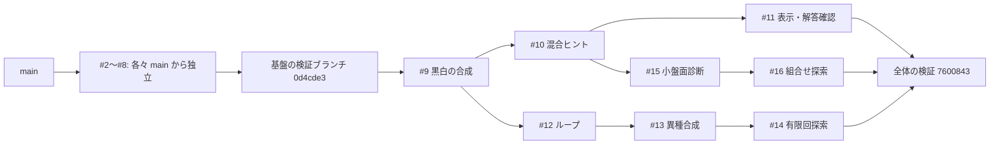

# 組合せ生成の現在地と PR #2〜#16 のレビューガイド

既存 DSL の正しさを修正したうえで、「黒白」「ループ」「黒白とループの相互制約」の生成と、
小盤面でのルール組合せ探索までを draft PR にまとめました。
**任意のルール同士を自動で接続して作問する汎用機構には、まだ一般化していません。**

本資料は **2026-11-03 UTC 時点**の確認結果です。#2〜#16 はすべて open / draft。
main は `c4164c27fb10c9847314b8c569a20a0aceec4075` のままで、マージ・デプロイはしていません。
この文書自体は main から分けた `codex/review-roadmap` の文書のみの変更です。
実装 PR の head/base を変更せず、文書の採否も実装の採否から独立させています。

## 最初に見るもの

- **試したい場合:** 下の「統合版を試す」へ。保存した問題の表示・答えの確認と、組合せ探索から生成までを試せます。
- **正しさをレビューする場合:** #2 と #7 の「何を同じ答えとするか」「どのモデルの値か」、続いて #4 の生成契約を確認してください。
- **本来の目標との距離を見る場合:** 「できたことと未対応」「次の改善の優先順位」を参照してください。
- **採用を判断する場合:** 下記一覧の各 PR と、その base に対する差分をレビューしてください。統合ブランチはまとめて動作を確認するための参照先です。

## PR 一覧と検証の読み方

テスト数は各 PR の head を単独で実行したときの総数です。base が異なるため、足し合わせる数ではありません。
#2・#3・#5〜#8 の単独ブランチにはテストCIがありません。表ではローカル検証と、当該変更を含む統合CIを区別しています。
#2・#3・#6〜#8 の単独 Pyright には既存22エラーが残り、追加診断はありません。#4 がそれらを修正しています。
表のCIはすべて Ubuntu / Windows × Python 3.12 / 3.13 の4環境で成功したものです。

### 基盤の修正

| PR / 検証した head | 目的 | 現在の base | 単独テスト / CIの根拠 | 範囲・注意点 |
| --- | --- | --- | --- | --- |
| [#2](https://github.com/airtoxin/puzzle-box/pull/2) / [`0d1031a`](https://github.com/airtoxin/puzzle-box/commit/0d1031aff2bf48b91257e65b9d7eea89c62cc83b) | 回答変数へ射影した一意性判定と `one_of` の真偽の同値化。Tents の対応付けを答えから除外。 | main | 149件 / [統合 #2〜#5](https://github.com/airtoxin/puzzle-box/actions/runs/41680340217) | 補助変数の違いで同じ盤面を別解扱いしない。空ループの既存仕様は維持。 |
| [#3](https://github.com/airtoxin/puzzle-box/pull/3) / [`33e771f`](https://github.com/airtoxin/puzzle-box/commit/33e771fcae16c23511f663fbd3bb514337bd62c7) | ぬりかべの島分離、候補なしの四角に切れ／タイリング、空の行列・矢印範囲の矛盾を反映。 | main | 121件 / [統合 #2〜#5](https://github.com/airtoxin/puzzle-box/actions/runs/41680340217) | 既存パズルの規則修正。新たな生成アダプタは追加しない。 |
| [#4](https://github.com/airtoxin/puzzle-box/pull/4) / [`850edfe`](https://github.com/airtoxin/puzzle-box/commit/850edfe0fc3e3e3d0fbedcec03e4a6509c4bdcd4) | 生成レシピ契約、初期ヒントの一意性、出現単位のヒント削減、型修正・資料・CI。 | main | 123件 / [単独](https://github.com/airtoxin/puzzle-box/actions/runs/41679924182) | 一意でない初期ヒントを成功として返さない。既約性は最少ヒント数ではない。 |
| [#5](https://github.com/airtoxin/puzzle-box/pull/5) / [`517bf53`](https://github.com/airtoxin/puzzle-box/commit/517bf535527a8cac58c5a7a73a936e912a78775a) | pytest 9.0.3 / Pygments 2.20.0 へ開発依存を更新。 | main | 108件 / [統合 #2〜#5](https://github.com/airtoxin/puzzle-box/actions/runs/41680340217) | 既存 Dependabot #1 と pytest の更新が重複する。 |
| [#6](https://github.com/airtoxin/puzzle-box/pull/6) / [`1c968d4`](https://github.com/airtoxin/puzzle-box/commit/1c968d483c520eeda38bc76d91468a5ef515bd7d) | 制約を組み立てる前に他のモデルの変数・式を拒否。 | main | 141件 / [統合 #2〜#6](https://github.com/airtoxin/puzzle-box/actions/runs/41682176095) | 変数の所属を検証する。ルール間の意味的な両立性の証明ではない。 |
| [#7](https://github.com/airtoxin/puzzle-box/pull/7) / [`ae2dcf4`](https://github.com/airtoxin/puzzle-box/commit/ae2dcf4bd36d44ad6fc5f4193942b748e55d09f6) | `Solution.value` を元モデルと求解時点のスナップショットに結び付ける。 | main | 115件 / [統合 #2〜#8](https://github.com/airtoxin/puzzle-box/actions/runs/41684005489) | 外部変数・求解後の新変数を拒否。直接 `Solution` を作る呼出側はモデルも渡す。 |
| [#8](https://github.com/airtoxin/puzzle-box/pull/8) / [`3de5ee1`](https://github.com/airtoxin/puzzle-box/commit/3de5ee16d8c42107655c3b2d52ef3635298aa21a) | マッチング候補の頂点・対・端点を検証し、孤立点にも次数制約を適用。 | main | 146件 / [統合 #2〜#8](https://github.com/airtoxin/puzzle-box/actions/runs/41684005489) | 不正入力と不成立を区別する。候補グラフ自体の自動生成は範囲外。 |

### 合成・生成・診断の実例

| PR / 検証した head | 目的 | 現在の base | 単独テスト / CIの根拠 | 範囲・注意点 |
| --- | --- | --- | --- | --- |
| [#9](https://github.com/airtoxin/puzzle-box/pull/9) / [`e014aad`](https://github.com/airtoxin/puzzle-box/commit/e014aadab295fb9f06a5f168d481dd88bd9c9eee) | 同じ黒白盤面に黒数・黒非接触・白連結・白2×2禁止を合成。生成・保存・検証。 | #2〜#8 の検証ブランチ | 286件 / [単独](https://github.com/airtoxin/puzzle-box/actions/runs/41687121374) | seed 指定時は1 worker。CLI は25マス以下。 |
| [#10](https://github.com/airtoxin/puzzle-box/pull/10) / [`19704ba`](https://github.com/airtoxin/puzzle-box/commit/19704ba6b1a7ad2913451090ade8993a8dec2eab) | セル、行、列の黒数ヒントを混在させる。 | #9 | 334件 / [単独](https://github.com/airtoxin/puzzle-box/actions/runs/41689983348) | 数ヒントだけで曖昧なら必要なセルを残す。数だけ指定時に勝手な補完をしない。 |
| [#11](https://github.com/airtoxin/puzzle-box/pull/11) / [`2a9507a`](https://github.com/airtoxin/puzzle-box/commit/2a9507a2b95fa4fbee9e58a51a916cd86c4bf788) | 黒白問題のテキスト表示、完全な解答の確認、明示的な解表示。 | #10 | 370件 / [単独](https://github.com/airtoxin/puzzle-box/actions/runs/41692739503) | 最小のCLI体験。ブラウザUI・途中解答への論理解説は未対応。 |
| [#12](https://github.com/airtoxin/puzzle-box/pull/12) / [`cca3967`](https://github.com/airtoxin/puzzle-box/commit/cca3967ebd573f35120b2e5ab3ec15d134ded274) | Slitherlink の単一非空ループ・長さ指定・数字／辺ヒントを合成。 | #9 | 338件 / [単独](https://github.com/airtoxin/puzzle-box/actions/runs/41697703899) | CLI は9マス以下。数字だけでは一意にならない例を辺ヒントで補う。 |
| [#13](https://github.com/airtoxin/puzzle-box/pull/13) / [`f32eecf`](https://github.com/airtoxin/puzzle-box/commit/f32eecf18d05709df62c9be6722c2bf95f2f65a5) | 固定矢印位置のヤジリンで黒白セルとループ辺を相互制約でつなぐ。 | #12 | 402件 / [単独](https://github.com/airtoxin/puzzle-box/actions/runs/41725547385) | CLI は12マス以下。答えは黒マスと辺の両方。矢印位置そのものは生成しない。 |
| [#14](https://github.com/airtoxin/puzzle-box/pull/14) / [`a8046a0`](https://github.com/airtoxin/puzzle-box/commit/a8046a09e59c7d7201d8ffe5756f34e81dcda660) | ヒント形式を固定したまま連続 seed を有限回試す。 | #13 | 423件 / [単独](https://github.com/airtoxin/puzzle-box/actions/runs/41726777890) | 既定1回、上限32回。初期ヒントが非一意の場合だけ再試行。時間・成功率の保証なし。 |
| [#15](https://github.com/airtoxin/puzzle-box/pull/15) / [`2b96512`](https://github.com/airtoxin/puzzle-box/commit/2b96512a68fd6d78ba6aafaa61022e9a17874487) | 小盤面を全列挙し、矛盾の最小部分集合、ヒント不足、多様性を診断。 | #10 | 393件 / [単独](https://github.com/airtoxin/puzzle-box/actions/runs/41729050868) | 9マス・8ルール出現・既存4型のみ。seed の観測頻度を確率と解釈しない。 |
| [#16](https://github.com/airtoxin/puzzle-box/pull/16) / [`1015009`](https://github.com/airtoxin/puzzle-box/commit/1015009a9f8b000722c5a69bf15588078f483f92) | 候補ルールの全部分集合を比較し、冗長性と一意性への寄与を反例付きで示す。 | #15 | 416件 / [単独](https://github.com/airtoxin/puzzle-box/actions/runs/41731772239) | 最大512盤面×256部分集合。全候補ヒントに対する判定であり、削減後へ一般化しない。 |

## 依存関係と推奨マージ順



矢印は現在のブランチの土台です。例えば #12 は #9 上に作ってありますが、
「Slitherlink のルールが黒白ルールを論理的に必要とする」という意味ではありません。
#11 と #15 は #10 から分かれた兄弟で、#12 は #10 ではなく #9 から分かれています。

採用する場合の一例は、実際の統合検証と同じ順序の
**#2 → #3 → #4 → #5 → #6 → #7 → #8 → #9 → #10 → #11 → #12 → #13 → #14 → #15 → #16** です。
#2〜#8 はそれぞれ main ベースの独立PRです。後半の兄弟系列は依存する親の後なら別順でも検討できますが、
別順の最終マージコミットを検証済みと扱わないでください。

採用時は以下の段階ごとに差分を確認します。この資料の作成に伴うマージ・rebase・PRの付け替えは実行していません。

1. **基盤 #2〜#8:** 個別にレビューし、採用した変更を取り込んだ状態でテスト・型検査・ビルドを実行する。#2 と #7 の交差部分は下記参照。
2. **#9 の土台を整理:** 現在の base は `codex/integration-value-matching-verification` / `0d4cde3`。
   これは #2〜#8 を cherry-pick した検証専用の履歴で、元PRのコミットIDとは一部異なる。
   基盤が実際の main に採用された後は、その main に **#9固有の変更だけ**を積み直し、
   base差分に基盤が重複しないことを確認する。base名の変更だけで整理できるとは限らない。
3. **#10以降の積み重ね:** 親の採用・squash・積み直しで履歴が変わったら、子の固有差分を維持して土台を更新する。
   親の変更が子PRに再掲されていないこと、各PRの目的とテストが残ることを確認する。
4. **最終状態の再検証:** 下記の589件と独立した小盤面検証を参照し、実際に採用した新しい head でCIを再実行する。
   過去の緑のCIを、別のマージ結果の証明として引き継がない。

基盤の一部を採用しない場合、後続を現在の検証済みセットから切り離す作業と再検証が必要です。
統合ブランチをそのまま一括採用することを、この資料では推奨していません。

## 競合・互換性で確認するところ

| 箇所 | 確認したこと | 採用時に保持する意味 |
| --- | --- | --- |
| #2 と #7 の `Puzzle.solve` / `Solution` | #7 を統合するときにテキスト競合が発生。解消済みの参考は [`ff9ef05`](https://github.com/airtoxin/puzzle-box/commit/ff9ef0539449dbe9bdcba02032a081fe227b22a7)。 | #2 の回答変数に射影した別解探索を保持し、#7 の `Solution(solver, self._model)` と値のスナップショットも保持する。どちらか片方に戻さない。 |
| #5 と既存 Dependabot [#1](https://github.com/airtoxin/puzzle-box/pull/1) | pytest の更新が重複。#1 は今回作成したPRではなく、変更していない。 | 更新の採用元を整理し、Pygments の更新も含めた lockfile の実際の結果を確認する。 |
| #9 の検証用 base | 基盤は cherry-pick された履歴。 | 前節のとおり、基盤の採用後に固有差分へ整理する。 |
| #10/#11 と #12〜#14、#15/#16 | 今回の統合では追加の手動競合解消は不要だった。READMEなど共有ファイルにも変更がある。 | 将来の競合なしを保証するものではない。各系列の説明・例・テストを両方残す。 |
| 外部から直接使うAPI | #6〜#8 は不正な所属・候補を早く拒否。#7 の直接コンストラクタは引数が増える。 | 正しい入力の既存動作に加え、不正入力で期待する例外と直接呼出側を確認する。 |
| 空ループ・矢印の役割 | 既存の `single_cycle` の空ループ許容は変更せず、#12/#13のレシピ側で非空を要求。矢印数字を削除しても位置の予約は残る。 | 仕様の違う操作を通常のヒント削減として混ぜない。ヤジリンの答えは黒マスとループ辺の両方を区別する。 |

## 統合版を試す

全変更の検証ブランチは `codex/integration-exploration-verification`、
検証した head は **`76008433026365b309d697c2110fbc618dfababd`** です。
以下は新しい作業ディレクトリで、この記録と同じコミットを使う例です。
この文書だけのブランチには、以下のCLIはまだ存在しません。

```sh
git clone --branch codex/integration-exploration-verification https://github.com/airtoxin/puzzle-box.git puzzle-box-review
cd puzzle-box-review
git switch --detach 76008433026365b309d697c2110fbc618dfababd
uv sync --all-packages --group dev --locked
```

保存済みの問題を表示し、保存された解と唯一解性を検証できます。

```sh
uv run --no-sync python examples/generate_shading.py show examples/shading-mixed-sample.json
uv run --no-sync python examples/generate_shading.py check examples/shading-mixed-sample.json --answer ".#.#/#.../...."
uv run --no-sync python examples/generate_shading.py verify examples/shading-mixed-sample.json
uv run --no-sync python examples/generate_slitherlink.py show examples/slitherlink-sample.json
uv run --no-sync python examples/generate_slitherlink.py verify examples/slitherlink-sample.json
uv run --no-sync python examples/generate_yajilin.py show examples/yajilin-sample.json
uv run --no-sync python examples/generate_yajilin.py verify examples/yajilin-sample.json
```

答えは `show ... --solution` で明示的に表示できます。保存JSON自体には答えも含まれています。
完全な解答を入力する `check` は現在、黒白CLIだけの機能です。

候補ルールを比較し、選んだ組合せを生成器へ渡す例です。

```sh
uv run --no-sync python examples/explore_shading.py
uv run --no-sync python examples/explore_shading.py --rows 3 --cols 3 --black-counts 3 --candidates count non-touching --explain 1 2
uv run --no-sync python examples/generate_shading.py generate --rows 3 --cols 3 --rules count non-touching --black-count 3 --hints cell row-count column-count --seed 6 --output found.json
uv run --no-sync python examples/generate_shading.py show found.json
uv run --no-sync python examples/generate_shading.py verify found.json
```

固定環境での確認結果は、行ヒント2個の唯一解・既約問題です。探索結果を生成器の引数へ移す部分は、まだ手動です。
診断 `analyze_shading.py` は1組のルールを詳しく調べ、探索 `explore_shading.py` は候補の全部分集合を比較します。

数字ヒントだけのヤジリンを、形式を変えず有限回試す例もあります。

```sh
uv run --no-sync python examples/generate_yajilin.py generate --hints arrow --seed 6 --attempts 3 --output arrows.json --quiet
uv run --no-sync python examples/generate_yajilin.py show arrows.json
uv run --no-sync python examples/generate_yajilin.py verify arrows.json
```

Python 3.12.14 / OR-Tools 9.15.6755 の確認環境ではseed 6・7は曖昧、8で成功しました。
同じseedからの異環境での同一出力や、成功率・実行時間は保証していません。

## 検証の到達点と限界

全体の統合では **589テスト成功、Pyright 0エラー・0警告、全4パッケージのsdist/wheelビルド成功**。
[統合CI](https://github.com/airtoxin/puzzle-box/actions/runs/41731632916) は上記 head に対し、
Ubuntu / Windows × Python 3.12 / 3.13 の4環境すべてで同じ検査に成功しました。
ローカルの主検証環境は Windows / Python 3.12.14 / OR-Tools 9.15.6755 です。
#16単独の416件を含め、各段階の根拠はPR一覧のリンクから確認できます。

テストは件数だけでなく、以下の反例と独立した検査を含みます。

- 補助変数や Tents の対応付けだけが違う場合を同じ可視解として扱うこと。
- 同じ黒白配置でも別ループがあれば、ヤジリンでは別解として扱うこと。
- 小盤面の全列挙と実際のDSLを照合し、生成後の唯一解と、残した各ヒントの必要性を確認すること。
- 「3×3・黒3個・非隣接」の22解中16解は全行列ヒントで一意となり、非隣接を外すとそのうち12解が一意でなくなること。
- 全セルヒントでは冗長なルールでも、ヒント削減後には必要になること。
  重複ルールは個別には冗長でも、同時に全部削除できるとは限らないこと。

これらは検査した有限盤面・ルール型に対する根拠です。任意のDSL式、大盤面、別寸法での同値性、
人間の解きやすさ、最低限のヒント数を証明するものではありません。
今回の文書PRは main ベースでCI定義を含まず、実装のCIは上記の固定コミットを参照しています。

## できたことと未対応

| 本来の目標 | 今ある具体例 | 残るギャップ |
| --- | --- | --- |
| ルール部品を組み合わせる | 同じ黒白グリッドの4ルール、ループの長さと数字／辺、ヤジリンのセルと辺の相互制約。 | 変数の意味・同じ空間・役割を自動で結び付ける共通の契約はない。数独・領域・対応付け等を自由に混ぜることは未実装。 |
| 組合せを発見する | 9マス・8候補出現以下の黒白全列挙。成立性・同じ答え集合・ルール削除の効果を比較。 | 対象は既存4ルール型と3ヒント形式。ループ／異種合成の組合せ探索、大盤面、対称性でまとめた比較は未対応。 |
| 組合せから作問する | 生成→候補ヒント抽出→一意性を保つ削減→保存→検証。セル等の補助ヒントを明示的に選べる。 | 全候補ヒントが曖昧なら失敗する。適切なヒント形式、矢印位置、未知のルール接続を自動設計することはない。 |
| 意味のあるルールを残す | 全候補ヒントを固定した場合の冗長性と一意性への寄与を反例付きで表示。 | 削減後の問題に対するルール・ヒントの同時最小化は未対応。「一意にする」と「人がそのルールを使って解く」は違う。 |
| 多様で再現可能な問題を作る | seed、環境、試行条件の記録。小盤面の正確な解数と、有限seedの観測を分離。 | 均一抽選・対称形の排除・成功率・異環境での出力一致・求解の時間上限は保証しない。 |
| 人が試して評価する | テキストで表示し、黒白では完全解答を確認。 | 途中手の検証、論理的な解法説明、難易度、遊びやすいUI、公開サービスは未対応。 |

## 次の改善の優先順位

以下は提案であり、この文書PRでの実装・採用はしていません。
最初から全パズルを統一する抽象化を加えず、既存例で検証可能な順に進めます。

| 優先 | 次の一歩 | 価値と根拠 | 小さな完了条件・限界 |
| --- | --- | --- | --- |
| P0 | 基盤のレビューと採用後の再検証 | 解の同一性・所属・生成契約が誤ると、後続の「唯一解」の意味が崩れる。 | #2/#7の両方の意味を保持し、採用した実headでCIを通す。マージ判断は別途行う。 |
| P1 | 探索で選んだレシピを保存し、そのまま生成・再検証する | 今は探索の出力からルール・寸法・ヒント形式を手で転記している。発見から作問までの切れ目を減らす。 | まず黒白4ルールに限定した版付きレシピ入力。探索→保存→読込→生成の往復テスト、不正な型・寸法・ヒント形式の拒否。答えやヒントの保存形式と区別する。 |
| P2 | 削減済みヒントに対するルールの寄与を診断する | 全候補ヒントでの冗長性だけでは、実際に出題した問題のルールを減らせない。 | 保存済みの小盤面で各ルールを1つ外し、候補解・唯一解性と反例を返す。複数の冗長ルールの一括削除や最小集合の保証はしない。 |
| P3 | 異種合成の小さな候補集合を探索する | 黒白と辺の連動は実証済みだが、探索対象は黒白だけ。主目的への次の拡張になる。 | 固定矢印位置のヤジリンから始め、空間・役割・黒白と辺の射影を明示する。結合則を外した反例を独立全列挙と照合し、任意型の自動接続とは呼ばない。 |
| P4 | 求解予算と終了理由、重複しない完成解の観測を整える | seed回数の上限は時間上限ではなく、seedを変えても同じ完成解になる場合がある。 | 時間切れ／不成立／複数解を区別し、時間切れを一意と認定しない。固定環境の答えIDで重複を測る。均一抽選や難易度の主張はしない。 |
| P5 | 人間向けの解き筋を限定ルールで評価する | 唯一解・既約性だけでは、面白い／解きやすい問題か判断できない。 | 既存黒白ルールの説明可能な少数の推論手順から始める。各手の健全性を反例探索で検査し、難易度の尺度は人の試遊と合わせて検討する。 |

## 詳細資料

以下のリンクは、実装がまだ main にない間も読めるよう、検証した統合コミットへ固定しています。
最初の調査資料は当時の main の記述なので、後続の修正状況は本資料と各PRを参照してください。

- [元の設計・実装・課題の調査](https://github.com/airtoxin/puzzle-box/blob/76008433026365b309d697c2110fbc618dfababd/docs/project-review.md)
- [Solution の所属・互換性](https://github.com/airtoxin/puzzle-box/blob/76008433026365b309d697c2110fbc618dfababd/docs/solution-values.md) / [マッチング入力契約](https://github.com/airtoxin/puzzle-box/blob/76008433026365b309d697c2110fbc618dfababd/docs/matching-inputs.md)
- [黒白ルール合成](https://github.com/airtoxin/puzzle-box/blob/76008433026365b309d697c2110fbc618dfababd/docs/composable-shading.md) / [混合ヒント](https://github.com/airtoxin/puzzle-box/blob/76008433026365b309d697c2110fbc618dfababd/docs/mixed-shading-clues.md) / [表示・解答確認](https://github.com/airtoxin/puzzle-box/blob/76008433026365b309d697c2110fbc618dfababd/docs/play-shading.md)
- [Slitherlink 合成](https://github.com/airtoxin/puzzle-box/blob/76008433026365b309d697c2110fbc618dfababd/docs/slitherlink-composition.md) / [ヤジリンと有限回探索](https://github.com/airtoxin/puzzle-box/blob/76008433026365b309d697c2110fbc618dfababd/docs/yajilin-composition.md)
- [小盤面の診断](https://github.com/airtoxin/puzzle-box/blob/76008433026365b309d697c2110fbc618dfababd/docs/shading-diagnostics.md) / [ルール組合せ探索](https://github.com/airtoxin/puzzle-box/blob/76008433026365b309d697c2110fbc618dfababd/docs/shading-exploration.md)
