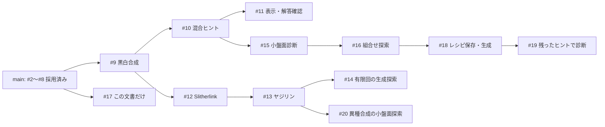

# 組合せ生成の現在地と PR #9〜#20 のレビューガイド

**#2〜#8 は main に採用済み、#9〜#20 は引き続き draft です。**
2026-11-04 UTC の土台は `dd7eb32b3b02170c9ddae2fe2031ea13d19181f3`。
#9 の base を main に変更し、後続にも採用後の修正を反映しました。
この資料は #17 の文書1ファイルの差分で、実装PRとは独立して採用できます。

既存 DSL による黒白・ループ・黒白と辺の相互制約、保存したレシピからの生成、
小盤面での組合せ探索まで動きます。任意のパズル型や DSL 式を自動接続する汎用機構にはしていません。

## 最初に見るもの

- **段階的にレビュー:** 下記の依存図とPR一覧。まず #9、以後は親の後で各系列を選べます。
- **まとめて試す:** 「統合版を試す」の固定コミット。統合ブランチは検証用で、一括採用を求めるものではありません。
- **次の開発を判断:** 「削減後の異種合成を調べる予備実験」と優先順位。全候補ヒントでの冗長性だけでは出題後を評価できません。

## 採用済みの基盤

| PR | 採用した内容 | 採用時に確認した点 |
| --- | --- | --- |
| [#2](https://github.com/airtoxin/puzzle-box/pull/2) | 回答変数に射影した一意性、`one_of` の同値化、Tents の対応付けを答えから除外。 | ユーザーがマージ。補助変数の違いを別の盤面と数えない。 |
| [#3](https://github.com/airtoxin/puzzle-box/pull/3) | ぬりかべの島分離、候補なしの配置、空の行列・矢印範囲の矛盾。 | 修正headで Copilot 指摘なし。後続で全基盤を再検証。 |
| [#4](https://github.com/airtoxin/puzzle-box/pull/4) | 生成レシピ契約、初期ヒントの一意性、出現単位のヒント削減、型修正・CI。 | 既約性は最少ヒント数ではない。 |
| [#5](https://github.com/airtoxin/puzzle-box/pull/5) | pytest / Pygments の開発依存更新。 | Dependabot [#1](https://github.com/airtoxin/puzzle-box/pull/1) と pytest 更新が重複。#1は変更していない。 |
| [#6](https://github.com/airtoxin/puzzle-box/pull/6) | 制約合成前に別モデルの変数・式を拒否。 | Copilot 指摘により、生の `Var` を返す連結 predicate も検査。所属検証36ケース。 |
| [#7](https://github.com/airtoxin/puzzle-box/pull/7) | `Solution.value` のモデル所属と求解時点のスナップショット。 | #2の射影別解探索と `Solution(solver, self._model)` の両方を保持。 |
| [#8](https://github.com/airtoxin/puzzle-box/pull/8) | マッチング候補の頂点・端点・重複を検査し、孤立点にも次数制約。 | 不正入力と不成立を区別。候補グラフの自動設計は行わない。 |

#3〜#8 は各修正headの Copilot レビューと検証を経てマージしました。
#6 のレビュー待ちの間に独立な #7・#8 を先に採用しています。
採用後 main の [CI](https://github.com/airtoxin/puzzle-box/actions/runs/41744404646) は
Ubuntu / Windows × Python 3.12 / 3.13 の4環境で259テスト・型検査・全4パッケージのビルド成功。
保護設定は変更していません。

## 現在の依存関係



矢印はブランチの依存です。#12 が #9 上にあることは、Slitherlink が黒白ルールを論理的に必要とする意味ではありません。
#11 と #15、#14 と #20 はそれぞれ兄弟です。#18・#19 は #11 に依存せず、#20 は #14〜#19 に依存しません。

推奨順は **#9 → #10 → #11 → #15 → #16 → #18 → #19** と、
**#9 → #12 → #13 → #14 / #20** の2系列です。#17 は任意の段階で独立にレビューできます。
異種合成を先に確認したい場合は、親を先に採用する条件で後者を優先できます。
実際に採用する順序で最終CIを確認してください。

## draft PR 一覧

以下は更新後headのスナップショットです。各PRの「Files changed」は記載のbaseとの比較です。
テスト件数は枝ごとに含む機能が違うため、合算しません。CIリンクは今回の更新headに対応します。

| PR / head | 目的 | 現在の base | 更新後の CI | 主な限界 |
| --- | --- | --- | --- | --- |
| [#9](https://github.com/airtoxin/puzzle-box/pull/9) / `adaafcf` | 黒数・黒非接触・白連結・白2×2禁止を合成し、生成・保存・検証。 | main | 290件 / [CI](https://github.com/airtoxin/puzzle-box/actions/runs/41746468614) | 同じ黒白セルの4型。CLIは25セル以下、seed指定時1 worker。 |
| [#10](https://github.com/airtoxin/puzzle-box/pull/10) / `910d00a` | セル、行、列の黒数ヒントを混在。 | #9 | 338件 / [CI](https://github.com/airtoxin/puzzle-box/actions/runs/41746470041) | 数だけで非一意なら成功としない。選んでいないヒントを補わない。 |
| [#11](https://github.com/airtoxin/puzzle-box/pull/11) / `2f994a6` | 黒白問題のテキスト表示、完全解答の確認。 | #10 | 374件 / [CI](https://github.com/airtoxin/puzzle-box/actions/runs/41746468611) | 途中手・論理的な解き筋・ブラウザUIは未対応。 |
| [#12](https://github.com/airtoxin/puzzle-box/pull/12) / `d03c317` | Slitherlink の非空単一ループ・長さ・数字／辺ヒント。 | #9 | 342件 / [CI](https://github.com/airtoxin/puzzle-box/actions/runs/41746470275) | CLIは9セル以下。数字だけでは非一意の場合がある。 |
| [#13](https://github.com/airtoxin/puzzle-box/pull/13) / `3d48d09` | ヤジリンで黒白セルとループ辺を相互制約で接続。 | #12 | 406件 / [CI](https://github.com/airtoxin/puzzle-box/actions/runs/41746470319) | 固定矢印位置、CLIは12セル以下。答えは黒白と辺の両方。 |
| [#14](https://github.com/airtoxin/puzzle-box/pull/14) / `6543fb8` | ヒント形式を変えず連続seedを有限回試す。 | #13 | 427件 / [CI](https://github.com/airtoxin/puzzle-box/actions/runs/41746471055) | 上限32回。初期ヒント非一意だけを再試行。時間・成功率の保証なし。 |
| [#15](https://github.com/airtoxin/puzzle-box/pull/15) / `514fb6b` | 小盤面の矛盾、ヒント不足、多様性を全列挙で診断。 | #10 | 397件 / [CI](https://github.com/airtoxin/puzzle-box/actions/runs/41746469684) | 9セル・8ルール出現・黒白4型。seed頻度を確率と解釈しない。 |
| [#16](https://github.com/airtoxin/puzzle-box/pull/16) / `5eaafde` | ルール部分集合と冗長性、一意性への寄与を比較。 | #15 | 420件 / [CI](https://github.com/airtoxin/puzzle-box/actions/runs/41746469391) | 最大512盤面×256部分集合。全候補ヒントに対する評価。 |
| [#17](https://github.com/airtoxin/puzzle-box/pull/17) | このレビューガイド。 | main | PR上の最新チェックを参照 | 文書1ファイルのみ。CLIはこの枝には存在しない。 |
| [#18](https://github.com/airtoxin/puzzle-box/pull/18) / `7d68098` | 探索レシピの保存→安全な読込→生成。 | #16 | 490件 / [CI](https://github.com/airtoxin/puzzle-box/actions/runs/41746470919) | 版付き黒白4型専用。未知の型・項目、重複JSONキー等を拒否。 |
| [#19](https://github.com/airtoxin/puzzle-box/pull/19) / `b1afb3c` | 削減後に残ったヒントを固定し、ルールを外した別解を表示。 | #18 | 531件 / [CI](https://github.com/airtoxin/puzzle-box/actions/runs/41746470420) | 保存された1問題の比較。冗長ルールの一括削除や同時最小化はしない。 |
| [#20](https://github.com/airtoxin/puzzle-box/pull/20) / `2330c56` | 黒白と辺の3規則の有無×3ヒント形式の有無を比較。 | #13 | 433件 / [CI](https://github.com/airtoxin/puzzle-box/actions/runs/41746470562) | 最大8セル・10辺。全候補ヒントのみ。規則を外した構成は通常のヤジリンではない。 |

## 土台の更新と競合をどう検証したか

- #9 の旧base `0d4cde3` は基盤を cherry-pick した検証履歴でした。実際の main を通常mergeで取り込み、baseを main に変更しました。
  重複履歴による8ファイルの競合は、**採用済みmainに旧#9の固有パッチをそのまま適用したtree**と一致するよう解消しました。
  mainの連結predicate検証・解スナップショットのテストを保持し、#9のseed設定も残しています。差分は元と同じ10ファイルです。
- 各子には更新した親を通常mergeしました。旧「親→子」差分を新しい親へ適用したtreeと、新しい子のtreeが10本すべて完全一致しました。
  force push、既存コミットの削除、新機能の混入はしていません。
- 兄弟系列を再統合すると、コードは自動で合流しました。#14と#20の `docs/yajilin-composition.md` だけは同じ末尾への追記で競合し、
  有限回探索と異種探索の説明を両方残しました。統合treeは前回検証済み `0660738` と完全一致しました。
- #17にもmainを取り込みました。baseとの差分は引き続き文書1ファイルです。本文更新だけを実装とは独立にレビューできます。

今回の再統合順は #11 系列 → #14 系列 → #19 系列 → #20 → #17。
上記はこの組合せでの結果で、将来の競合なしや別順のマージ結果を保証しません。
新headに対する後続PRの Copilot レビューはまだ依頼していません。古いレビューを新headの承認として扱わないでください。

将来、親PRを採用したら、そのmainと子の差分を再確認してから子のbaseをmainへ移します。
通常mergeなら今回の親履歴も祖先になりますが、squash/rebase採用では履歴が変わるため再整理が必要です。
親のコードが子のPRに再掲されていないこと、CIが新しい組合せに対して成功していることを確認します。
#9以降のready化・マージは今回行っていません。

## 統合版を試す

更新した各PRの実際の履歴を合わせた検証ブランチは `codex/integration-refreshed-drafts`。
機能を固定して試すコミットは **`f68a0436ff3d7d546112df3e2bd12496644c5643`** です。
この文書だけの枝には、以下のCLIはありません。新しいディレクトリで実行してください。

```sh
git clone --branch codex/integration-refreshed-drafts https://github.com/airtoxin/puzzle-box.git puzzle-box-review
cd puzzle-box-review
git switch --detach f68a0436ff3d7d546112df3e2bd12496644c5643
uv sync --all-packages --group dev --locked
uv run --no-sync python examples/generate_shading.py show examples/shading-mixed-sample.json
uv run --no-sync python examples/generate_shading.py verify examples/shading-mixed-sample.json
uv run --no-sync python examples/generate_slitherlink.py verify examples/slitherlink-sample.json
uv run --no-sync python examples/generate_yajilin.py verify examples/yajilin-sample.json
```

保存JSONには答えも含まれます。明示的に答えを見るときは `show FILE --solution`、
黒白で完全解答を確認するときは `check FILE --answer ".#.#/#.../...."` を使います。

探索→レシピ保存→生成→削減後のルール診断まで、引数の手動転記なしで試せます。

```sh
uv run --no-sync python examples/explore_shading.py --rows 3 --cols 3 --black-counts 3 --candidates count non-touching --hints cell row-count column-count --explain 1 2 --export-recipe chosen.json
uv run --no-sync python examples/generate_shading.py generate --recipe chosen.json --seed 6 --output puzzle.json
uv run --no-sync python examples/generate_shading.py verify puzzle.json
uv run --no-sync python examples/diagnose_shading_rules.py puzzle.json
uv run --no-sync python examples/explore_coupled.py --verify-models --explain 3 --hints black
uv run --no-sync python examples/explore_coupled.py --arrow 0 1 down --verify-models --explain 3 --hints arrow
```

Python 3.12.14 / OR-Tools 9.15.6755では、黒白の例は行ヒント2個に削減され、
黒数ルールを外すと2解、非隣接を外すと9解になります。
異種探索の例は、同じ黒白盤面に外周1ループ／離れた2ループがある反例と、結合＋非隣接が矛盾する配置です。
異環境でseedから同じ出力になることは保証しません。

## 検証結果

更新後の実装11PRは、それぞれ Ubuntu / Windows × Python 3.12 / 3.13 の全4環境で成功しました。
再統合 `f68a043` の [CI](https://github.com/airtoxin/puzzle-box/actions/runs/41747170388) も全4環境で731テスト成功、Pyright 0エラー・0警告、全4パッケージのsdist/wheelビルド成功です。
ローカルの再統合は730成功・1スキップ（ハードリンク権限）で、CIではその試験も成功しました。
文書の10個のCLI実行例と1個のPython例、固定コミットへの資料リンク、Markdownのコードフェンスも検証しています。
#17自身の文書更新に対するCIは、PR上の最新チェックを参照してください。統合ブランチに後からこの資料だけを反映した場合も、機能の固定再現点は上記コミットです。

テストは件数だけでなく、独立な全列挙との一致、補助変数を除いた回答の射影、
初期ヒントの一意性、残したヒントの必要性、安全なレシピ入力、CLIの再現性を確認しています。
ローカルは Windows / Python 3.12.14 / OR-Tools 9.15.6755。
一部のハードリンク試験はローカル権限でskipになるため、CIの実行結果と区別します。
サイズ制限は実行時間の上限ではなく、大盤面の性能・人間の難易度・最少ヒント数は未検証です。

## 削減後の異種合成を調べる予備実験

次の候補として、#20の「全候補ヒント」に対する比較を、実際に削減したヒントへ広げる価値を確認しました。
2×4・矢印なし・全白の外周ループについて、黒白8個＋辺10個の18ヒントから順に不要なものを外す実験です。

| 規則 | 残ったヒント | 規則を1つ外したときの解数（同じ削減後ヒントを固定） |
| --- | --- | --- |
| 結合のみ（mask 1） | 内部の縦辺2本を使わない | 結合を外すと256解 |
| 結合＋非隣接（mask 3） | `(0,2)-(1,2)` を使わない | 結合を外すと123解、非隣接を外すと3解 |
| 3規則すべて（mask 7） | 0ヒント | 結合を外すと246解、非隣接を外すと6解、単一サイクルを外すと2解 |

元の18ヒントを全部固定すると、どの行でも各規則を外して1解のままです。
削減後の解集合は独立列挙器とDSLモデルの両方で照合しました。
1つの完成解と固定削減順の実験であり、他の配置・最少ヒント数・難易度の証明ではありません。
新たな生成・保存APIはまだ追加していません。mask 3の中心となる反例は、統合版のルートから次で再現できます。

```python
import sys
sys.path.insert(0, "examples")
from coupled_oracle import accepts, universe
from explore_coupled import CoupledModel, model_answers
from puzzle import Edge, Vertex
from puzzle_defs import YajilinRecipe

recipe = YajilinRecipe(2, 4, ())
edge = Edge(Vertex(0, 2), Vertex(1, 2))
space = universe(recipe)
for mask, count in [(3, 1), (2, 123), (1, 3)]:
    expected = {a for a in space if accepts(recipe, mask, a) and edge not in a.loop_edges}
    model = CoupledModel(recipe, mask)
    model.add(model.edge_on[edge] == 0)
    actual, _ = model_answers(model)
    assert actual == expected and len(actual) == count
    print(mask, count)
```

## 次の優先順位と残るギャップ

旧計画のレシピ保存・生成接続は #18、保存ヒント診断は #19、異種探索は #20で限定範囲を実装済みです。
基盤の採用は完了しました。後続はレビュー待ちであり、mainで利用可能になったという意味ではありません。

| 優先 | 次の一歩 | 小さな完了条件・制限 |
| --- | --- | --- |
| P0 | 上記依存順で後続をレビュー | 各PRの差分・新headのCI・必要なレビューを確認。ready化と採用は別の指示に従う。 |
| P1 | 異種探索で選んだ規則・答えからヒントを削減し、その問題で規則の寄与を比較 | まず #20 の8セル・3規則だけ。黒白＋辺の射影、固定ヒント、別解証拠を保ち、上の123解／3解を回帰例にする。通常ヤジリンの形式に異なる規則を偽装しない。 |
| P2 | 異種の設定・問題を版付きで保存し、探索から生成へ接続 | #18の厳密な入力検証を参考にする。mask 0〜6の意味を明示し、既存ヤジリン形式との互換性を区別。任意Python式の実行や汎用DSL直列化はしない。 |
| P3 | 求解予算・終了理由・多様性を可視化 | 時間切れ、不成立、複数解を区別し、未完了を唯一解と認定しない。同一答えの重複を測り、対称性による分類は座標一致とは別に扱う。 |
| P4 | 説明可能な少数の推論規則で人間の解き筋を評価 | 各手を反例探索で検証し、試遊と合わせる。唯一解や既約性だけで面白さ・難易度を主張しない。 |

未対応なのは、数独・領域・マッチング等を任意に接続する共通契約、ヒント位置の自動設計、
ルールとヒントの同時最小化、対称形を除いた均一抽選、途中解答の説明、遊びやすいUIです。
具体例で意味と検証方法を確かめてから抽象化する方針を維持します。

## 詳細資料

以下は今回の更新前後で内容を保持した機能資料です。固定統合コミットで参照できます。

- [元の設計・課題](https://github.com/airtoxin/puzzle-box/blob/f68a0436ff3d7d546112df3e2bd12496644c5643/docs/project-review.md)
- [黒白合成](https://github.com/airtoxin/puzzle-box/blob/f68a0436ff3d7d546112df3e2bd12496644c5643/docs/composable-shading.md) / [混合ヒント](https://github.com/airtoxin/puzzle-box/blob/f68a0436ff3d7d546112df3e2bd12496644c5643/docs/mixed-shading-clues.md) / [遊ぶCLI](https://github.com/airtoxin/puzzle-box/blob/f68a0436ff3d7d546112df3e2bd12496644c5643/docs/play-shading.md)
- [Slitherlink](https://github.com/airtoxin/puzzle-box/blob/f68a0436ff3d7d546112df3e2bd12496644c5643/docs/slitherlink-composition.md) / [ヤジリンと有限回探索](https://github.com/airtoxin/puzzle-box/blob/f68a0436ff3d7d546112df3e2bd12496644c5643/docs/yajilin-composition.md)
- [小盤面診断](https://github.com/airtoxin/puzzle-box/blob/f68a0436ff3d7d546112df3e2bd12496644c5643/docs/shading-diagnostics.md) / [組合せ探索](https://github.com/airtoxin/puzzle-box/blob/f68a0436ff3d7d546112df3e2bd12496644c5643/docs/shading-exploration.md)
- [レシピ保存と生成](https://github.com/airtoxin/puzzle-box/blob/f68a0436ff3d7d546112df3e2bd12496644c5643/docs/shading-recipe-files.md) / [保存ヒントの診断](https://github.com/airtoxin/puzzle-box/blob/f68a0436ff3d7d546112df3e2bd12496644c5643/docs/stored-clue-rule-diagnostics.md) / [異種合成の探索](https://github.com/airtoxin/puzzle-box/blob/f68a0436ff3d7d546112df3e2bd12496644c5643/docs/coupled-rule-exploration.md)
