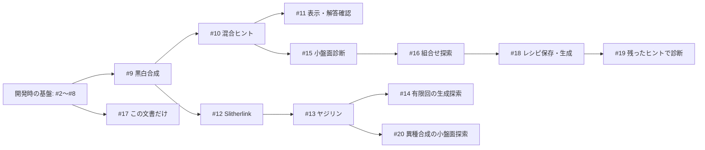

# 組合せ生成の現在地と PR #9〜#20 のレビューガイド

**#2〜#16・#18〜#20 の実装は main に採用済みです。**
2026-11-04 UTC、各PRを ready にし、Copilot の修正後レビューと4環境のCIを確認して依存順に採用しました。
実装の固定再現点は `f613b97e5591f81369697bfd3ec57a8fc1eb10b1`（#20 採用後）。
#17 はこの文書1ファイルだけのPRで、最新状態・レビュー・チェックは [PR #17](https://github.com/airtoxin/puzzle-box/pull/17) を参照してください。
追加の保存問題診断 [#21](https://github.com/airtoxin/puzzle-box/pull/21) は別の draft です。下記の main の機能には含めません。

既存 DSL による黒白・ループ・黒白と辺の相互制約、保存したレシピからの生成、
小盤面での組合せ探索まで動きます。任意のパズル型や DSL 式を自動接続する汎用機構にはしていません。

## 最初に見るもの

- **変更を確認:** 下記の依存図と、採用したhead・CIの一覧。各PRの目的と差分を追えます。
- **まとめて試す:** 「採用版を試す」の main と固定コミット。過去の統合ブランチを取得する必要はありません。
- **次の開発を判断:** 「削減後の異種合成を調べる予備実験」と優先順位。全候補ヒントでの冗長性だけでは出題後を評価できません。

## 採用済みの基盤

| PR | 採用した内容 | 採用時に確認した点 |
| --- | --- | --- |
| [#2](https://github.com/airtoxin/puzzle-box/pull/2) | 回答変数に射影した一意性、`one_of` の同値化、Tents の対応付けを答えから除外。 | ユーザーがマージ。補助変数の違いを別の盤面と数えない。 |
| [#3](https://github.com/airtoxin/puzzle-box/pull/3) | ぬりかべの島分離、候補なしの配置、空の行列・矢印範囲の矛盾。 | 修正headで Copilot 指摘なし。後続で全基盤を再検証。 |
| [#4](https://github.com/airtoxin/puzzle-box/pull/4) | 生成レシピ契約、初期ヒントの一意性、出現単位のヒント削減、型修正・CI。 | 既約性は最少ヒント数ではない。 |
| [#5](https://github.com/airtoxin/puzzle-box/pull/5) | pytest / Pygments の開発依存更新。 | Dependabot [#1](https://github.com/airtoxin/puzzle-box/pull/1) と pytest 更新が重複。#1は変更していない。 |
| [#6](https://github.com/airtoxin/puzzle-box/pull/6) | 制約合成前に別モデルの変数・式を拒否。 | Copilot 指摘により、生の `Var` を返す連結 predicate も検査。所属検証36ケース。 |
| [#7](https://github.com/airtoxin/puzzle-box/pull/7) | `Solution.value` のモデル所属と求解時点のスナップショット。 | #2の射影別解探索と `Solution(solver, self._model)` の両方を保持。 |
| [#8](https://github.com/airtoxin/puzzle-box/pull/8) | マッチング候補の頂点・端点・重複を検査し、孤立点にも次数制約。 | 不正入力と不成立を区別。候補グラフの自動設計は行わない。 |

#3〜#8 は各修正headの Copilot レビューと検証を経てマージしました。
#6 のレビュー待ちの間に独立な #7・#8 を先に採用しています。
採用後 main の [CI](https://github.com/airtoxin/puzzle-box/actions/runs/41744404646) は
Ubuntu / Windows × Python 3.12 / 3.13 の4環境で259テスト・型検査・全4パッケージのビルド成功。
保護設定は変更していません。

## 開発時の機能・ブランチ依存



矢印は開発時の依存です。現在の対象実装はすべて main に含まれています。
#12 が #9 上にあったことは、Slitherlink が黒白ルールを論理的に必要とする意味ではありません。
#11 と #15、#14 と #20 は機能上の兄弟です。#18・#19 は #11 に、#20 は #14〜#19 に論理的には依存しません。

実際の採用順は **#9 → #10 → #15 → #16 → #18 → #19 → #11 → #12 → #13 → #14 → #20**。
別系列の採用後に main の内容が増えた場合は、その内容を通常mergeで取り込み、最新headで再レビューしました。
一時的に #12 のbaseを #11、#20 を #14 にして固有差分を確認し、親採用後は同じtreeの main に移しています。
#17 の文書は実装とは独立です。マージ・保護設定の迂回や force push は行っていません。

## 採用した PR と検証記録

以下は採用したheadと、そのheadのPR CIです。#17以外は main へ通常merge済みです。
各実装PRで、最新headに対する Copilot の「Approval recommended / No open issues」と未解決スレッドなしを確認しました。
Copilot の結果は COMMENTED として記録されるため、人間の APPROVED と同一視していません。
テスト件数は各時点で含む機能が違うため合算しません。CIはすべて4環境のテスト・型検査・ビルド成功です。

| PR / 採用head | 目的 | 採用先 | 採用時の CI | 主な限界 |
| --- | --- | --- | --- | --- |
| [#9](https://github.com/airtoxin/puzzle-box/pull/9) / `389dff2` | 黒数・黒非接触・白連結・白2×2禁止を合成し、生成・保存・検証。 | main | 290件 / [CI](https://github.com/airtoxin/puzzle-box/actions/runs/41749321123) | 同じ黒白セルの4型。CLIは25セル以下、seed指定時1 worker。 |
| [#10](https://github.com/airtoxin/puzzle-box/pull/10) / `c69fb20` | セル、行、列の黒数ヒントを混在。 | main | 338件 / [CI](https://github.com/airtoxin/puzzle-box/actions/runs/41749763731) | 数だけで非一意なら成功としない。選んでいないヒントを補わない。 |
| [#11](https://github.com/airtoxin/puzzle-box/pull/11) / `4346e60` | 黒白問題のテキスト表示、完全解答の確認。 | main | 567件 / [CI](https://github.com/airtoxin/puzzle-box/actions/runs/41752404778) | 途中手・論理的な解き筋・ブラウザUIは未対応。 |
| [#12](https://github.com/airtoxin/puzzle-box/pull/12) / `b5e2724` | Slitherlink の非空単一ループ・長さ・数字／辺ヒント。 | main | 619件 / [CI](https://github.com/airtoxin/puzzle-box/actions/runs/41752526371) | CLIは9セル以下。数字だけでは非一意の場合がある。 |
| [#13](https://github.com/airtoxin/puzzle-box/pull/13) / `6d14015` | ヤジリンで黒白セルとループ辺を相互制約で接続。 | main | 683件 / [CI](https://github.com/airtoxin/puzzle-box/actions/runs/41752591118) | 固定矢印位置、CLIは12セル以下。答えは黒白と辺の両方。 |
| [#14](https://github.com/airtoxin/puzzle-box/pull/14) / `1346dff` | ヒント形式を変えず連続seedを有限回試す。 | main | 704件 / [CI](https://github.com/airtoxin/puzzle-box/actions/runs/41752647172) | 上限32回。初期ヒント非一意だけを再試行。時間・成功率の保証なし。 |
| [#15](https://github.com/airtoxin/puzzle-box/pull/15) / `cf782ec` | 小盤面の矛盾、ヒント不足、多様性を全列挙で診断。 | main | 397件 / [CI](https://github.com/airtoxin/puzzle-box/actions/runs/41749759458) | 9セル・8ルール出現・黒白4型。seed頻度を確率と解釈しない。 |
| [#16](https://github.com/airtoxin/puzzle-box/pull/16) / `08eb151` | ルール部分集合と冗長性、一意性への寄与を比較。 | main | 420件 / [CI](https://github.com/airtoxin/puzzle-box/actions/runs/41749762530) | 最大512盤面×256部分集合。全候補ヒントに対する評価。 |
| [#17](https://github.com/airtoxin/puzzle-box/pull/17) | このレビューガイド。 | main | PR上の最新チェックを参照 | 差分は文書1ファイルのみ。実装は採用済みmainを含む。 |
| [#18](https://github.com/airtoxin/puzzle-box/pull/18) / `7ca6f16` | 探索レシピの保存→安全な読込→生成。 | main | 490件 / [CI](https://github.com/airtoxin/puzzle-box/actions/runs/41749763787) | 版付き黒白4型専用。未知の型・項目、重複JSONキー等を拒否。 |
| [#19](https://github.com/airtoxin/puzzle-box/pull/19) / `2436498` | 削減後に残ったヒントを固定し、ルールを外した別解を表示。 | main | 531件 / [CI](https://github.com/airtoxin/puzzle-box/actions/runs/41749762996) | 保存された1問題の比較。冗長ルールの一括削除や同時最小化はしない。 |
| [#20](https://github.com/airtoxin/puzzle-box/pull/20) / `d44e73e` | 黒白と辺の3規則の有無×3ヒント形式の有無を比較。 | main | 731件 / [CI](https://github.com/airtoxin/puzzle-box/actions/runs/41752761628) | 最大8セル・10辺。全候補ヒントのみ。規則を外した構成は通常のヤジリンではない。 |

## 土台の更新と競合をどう検証したか

- #9 の旧base `0d4cde3` は基盤を cherry-pick した検証履歴でした。実際の main を通常mergeで取り込み、baseを main に変更しました。
  重複履歴による8ファイルの競合は、**採用済みmainに旧#9の固有パッチをそのまま適用したtree**と一致するよう解消しました。
  mainの連結predicate検証・解スナップショットのテストを保持し、#9のseed設定も残しています。差分は元と同じ10ファイルです。
- 各子には更新した親を通常mergeしました。旧「親→子」差分を新しい親へ適用したtreeと、新しい子のtreeが10本すべて完全一致しました。
  force push、既存コミットの削除、新機能の混入はしていません。
- 兄弟系列を再統合すると、コードは自動で合流しました。#14と#20の `docs/yajilin-composition.md` だけは同じ末尾への追記で競合し、
  有限回探索と異種探索の説明を両方残しました。統合treeは前回検証済み `0660738` と完全一致しました。
- #17にもmainを取り込みました。baseとの差分は引き続き文書1ファイルです。本文更新だけを実装とは独立にレビューできます。

基盤更新時の統合順は #11 系列 → #14 系列 → #19 系列 → #20 → #17 でした。
今回の実際の採用順は上記のとおりで、各マージ後に base と固有差分を再確認しました。
親の採用後mainと元の親headのtreeが一致する場合は、子のheadを変えずbaseを更新しました。
兄弟系列が既に採用されていた場合は内容を取り込み、新headのCIと再レビューを確認しています。
将来、squash/rebaseで採用すると履歴が変わるため、この手順だけで無競合とは保証できません。

Copilot の文書指摘は #9・#12 の古い依存説明、#17 の draft と未マージの混同でした。
修正して再レビュー済みです。さらに #11 の main 取り込み後、テスト単独実行の import 失敗が見つかりました。
`shading-play-test.py` だけの実行で10成功・26 setup errorを再現し、スクリプト読込時だけ検索パスを追加するよう修正しました。
修正後は単独36件成功、全体567件成功。Copilot は修正を解決済みと確認しています。
全体テストだけでは他モジュールの検索パスに隠れる失敗であり、単独実行の確認も必要だった事例です。

## 採用版を試す

採用済み実装を固定して試すコミットは **`f613b97e5591f81369697bfd3ec57a8fc1eb10b1`** です。
mainから取得できます。既存の作業を保つため、新しいディレクトリで試してください。

```sh
git clone https://github.com/airtoxin/puzzle-box.git puzzle-box-review
cd puzzle-box-review
git switch --detach f613b97e5591f81369697bfd3ec57a8fc1eb10b1
uv sync --all-packages --group dev --locked
uv run --no-sync python examples/generate_shading.py show examples/shading-mixed-sample.json
uv run --no-sync python examples/generate_shading.py verify examples/shading-mixed-sample.json
uv run --no-sync python examples/generate_slitherlink.py verify examples/slitherlink-sample.json
uv run --no-sync python examples/generate_yajilin.py verify examples/yajilin-sample.json
```

保存JSONには答えも含まれます。明示的に答えを見るときは `show FILE --solution`、
黒白で完全解答を確認するときは `check FILE --answer ".#.#/#.../...."` を使います。

探索→レシピ保存→生成→削減後のルール診断まで、引数の手動転記なしで試せます。

```sh
uv run --no-sync python examples/explore_shading.py --rows 3 --cols 3 --black-counts 3 --candidates count non-touching --hints cell row-count column-count --explain 1 2 --export-recipe chosen.json
uv run --no-sync python examples/generate_shading.py generate --recipe chosen.json --seed 6 --output puzzle.json
uv run --no-sync python examples/generate_shading.py verify puzzle.json
uv run --no-sync python examples/diagnose_shading_rules.py puzzle.json
uv run --no-sync python examples/explore_coupled.py --verify-models --explain 3 --hints black
uv run --no-sync python examples/explore_coupled.py --arrow 0 1 down --verify-models --explain 3 --hints arrow
```

Python 3.12.14 / OR-Tools 9.15.6755では、黒白の例は行ヒント2個に削減され、
黒数ルールを外すと2解、非隣接を外すと9解になります。
異種探索の例は、同じ黒白盤面に外周1ループ／離れた2ループがある反例と、結合＋非隣接が矛盾する配置です。
異環境でseedから同じ出力になることは保証しません。

## 検証結果

採用した実装11PRは、それぞれ Ubuntu / Windows × Python 3.12 / 3.13 の全4環境で成功しました。
全機能を含む #20 の [CI](https://github.com/airtoxin/puzzle-box/actions/runs/41752761628) は731テスト、
Pyright 0エラー・0警告、全4パッケージのsdist/wheelビルド成功です。
ローカル統合は730成功・1スキップ（ハードリンク作成権限）で、CIではその試験も成功しました。
以前の統合 `f68a043` の [CI](https://github.com/airtoxin/puzzle-box/actions/runs/41747170388) も731件成功でしたが、
今回の採用では #11 の単独実行修正を含む最新headを使いました。
文書の10個のCLI実行例と1個のPython例は基盤更新時に検証しています。採用版でリンク先とCLIの内容を再確認しました。
#17 自身の最新文書CIと、採用後 main のチェックは GitHub の各PR・Actionsを参照してください。

テストは件数だけでなく、独立な全列挙との一致、補助変数を除いた回答の射影、
初期ヒントの一意性、残したヒントの必要性、安全なレシピ入力、CLIの再現性を確認しています。
ローカルは Windows / Python 3.12.14 / OR-Tools 9.15.6755。
一部のハードリンク試験はローカル権限でskipになるため、CIの実行結果と区別します。
サイズ制限は実行時間の上限ではなく、大盤面の性能・人間の難易度・最少ヒント数は未検証です。

## 削減後の異種合成を調べる予備実験

次の候補として、#20の「全候補ヒント」に対する比較を、実際に削減したヒントへ広げる価値を確認しました。
2×4・矢印なし・全白の外周ループについて、黒白8個＋辺10個の18ヒントから順に不要なものを外す実験です。

| 規則 | 残ったヒント | 規則を1つ外したときの解数（同じ削減後ヒントを固定） |
| --- | --- | --- |
| 結合のみ（mask 1） | 内部の縦辺2本を使わない | 結合を外すと256解 |
| 結合＋非隣接（mask 3） | `(0,2)-(1,2)` を使わない | 結合を外すと123解、非隣接を外すと3解 |
| 3規則すべて（mask 7） | 0ヒント | 結合を外すと246解、非隣接を外すと6解、単一サイクルを外すと2解 |

元の18ヒントを全部固定すると、どの行でも各規則を外して1解のままです。
削減後の解集合は独立列挙器とDSLモデルの両方で照合しました。
1つの完成解と固定削減順の実験であり、他の配置・最少ヒント数・難易度の証明ではありません。
採用版には新たな生成・保存APIをまだ追加していません。mask 3の中心となる反例は、リポジトリのルートから次で再現できます。

```python
import sys
sys.path.insert(0, "examples")
from coupled_oracle import accepts, universe
from explore_coupled import CoupledModel, model_answers
from puzzle import Edge, Vertex
from puzzle_defs import YajilinRecipe

recipe = YajilinRecipe(2, 4, ())
edge = Edge(Vertex(0, 2), Vertex(1, 2))
space = universe(recipe)
for mask, count in [(3, 1), (2, 123), (1, 3)]:
    expected = {a for a in space if accepts(recipe, mask, a) and edge not in a.loop_edges}
    model = CoupledModel(recipe, mask)
    model.add(model.edge_on[edge] == 0)
    actual, _ = model_answers(model)
    assert actual == expected and len(actual) == count
    print(mask, count)
```

## 次の優先順位と残るギャップ

旧計画のレシピ保存・生成接続は #18、保存ヒント診断は #19、異種探索は #20で限定範囲を実装済みです。
対象の実装は main に採用済みです。追加の [#21](https://github.com/airtoxin/puzzle-box/pull/21) は保存問題に対する異種ルール診断の draft で、上記の採用版には含まれません。

| 優先 | 次の一歩 | 小さな完了条件・制限 |
| --- | --- | --- |
| 完了 | #9〜#20 の実装を依存順に採用 | 修正後レビュー・4環境CIを確認。#17の文書の現在状態はPRを参照。 |
| P1 | 保存問題に対する異種診断 #21 をレビュー | 8セル・3規則、保存ヒントを固定、黒白＋辺の射影と別解証拠。123解／3解を含む58ケースを追加。通常ヤジリンを直接読み、異なる規則は別形式。生成・削減APIの追加は含まない。 |
| P2 | 異種の設定・問題を版付きで保存し、探索から生成へ接続 | #18の厳密な入力検証を参考にする。mask 0〜6の意味を明示し、既存ヤジリン形式との互換性を区別。任意Python式の実行や汎用DSL直列化はしない。 |
| P3 | 求解予算・終了理由・多様性を可視化 | 時間切れ、不成立、複数解を区別し、未完了を唯一解と認定しない。同一答えの重複を測り、対称性による分類は座標一致とは別に扱う。 |
| P4 | 説明可能な少数の推論規則で人間の解き筋を評価 | 各手を反例探索で検証し、試遊と合わせる。唯一解や既約性だけで面白さ・難易度を主張しない。 |

未対応なのは、数独・領域・マッチング等を任意に接続する共通契約、ヒント位置の自動設計、
ルールとヒントの同時最小化、対称形を除いた均一抽選、途中解答の説明、遊びやすいUIです。
具体例で意味と検証方法を確かめてから抽象化する方針を維持します。

## 詳細資料

以下は採用済み実装に対応する資料です。固定コミットで参照できます。

- [元の設計・課題](https://github.com/airtoxin/puzzle-box/blob/f613b97e5591f81369697bfd3ec57a8fc1eb10b1/docs/project-review.md)
- [黒白合成](https://github.com/airtoxin/puzzle-box/blob/f613b97e5591f81369697bfd3ec57a8fc1eb10b1/docs/composable-shading.md) / [混合ヒント](https://github.com/airtoxin/puzzle-box/blob/f613b97e5591f81369697bfd3ec57a8fc1eb10b1/docs/mixed-shading-clues.md) / [遊ぶCLI](https://github.com/airtoxin/puzzle-box/blob/f613b97e5591f81369697bfd3ec57a8fc1eb10b1/docs/play-shading.md)
- [Slitherlink](https://github.com/airtoxin/puzzle-box/blob/f613b97e5591f81369697bfd3ec57a8fc1eb10b1/docs/slitherlink-composition.md) / [ヤジリンと有限回探索](https://github.com/airtoxin/puzzle-box/blob/f613b97e5591f81369697bfd3ec57a8fc1eb10b1/docs/yajilin-composition.md)
- [小盤面診断](https://github.com/airtoxin/puzzle-box/blob/f613b97e5591f81369697bfd3ec57a8fc1eb10b1/docs/shading-diagnostics.md) / [組合せ探索](https://github.com/airtoxin/puzzle-box/blob/f613b97e5591f81369697bfd3ec57a8fc1eb10b1/docs/shading-exploration.md)
- [レシピ保存と生成](https://github.com/airtoxin/puzzle-box/blob/f613b97e5591f81369697bfd3ec57a8fc1eb10b1/docs/shading-recipe-files.md) / [保存ヒントの診断](https://github.com/airtoxin/puzzle-box/blob/f613b97e5591f81369697bfd3ec57a8fc1eb10b1/docs/stored-clue-rule-diagnostics.md) / [異種合成の探索](https://github.com/airtoxin/puzzle-box/blob/f613b97e5591f81369697bfd3ec57a8fc1eb10b1/docs/coupled-rule-exploration.md)
