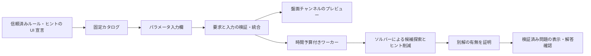

# ルールの UI 要求から構成する Web アプリ

このアプリは、[黒白セルの組み込み47ルール](composable-shading.md)から最大8種類（最大100セル、ルール固有の上限あり）、スリザーリンク（4セル以下）、黒白とセル中心ループの固定3条件（9セル以下）から問題を生成するローカルの実験です。
ルール定義が宣言するパラメータ・盤面チャンネルをサーバーで統合し、ブラウザがその計画から描画します。
任意の Python ルールや異なる盤面型が、そのまま使える仕組みではありません。
Vercelで利用する場合は、ローカルHTTPサーバーとは別の[配信手順と計算制限](deploy-vercel.md)に従います。

## 起動と操作

リポジトリのルートで実行します。アプリの実行に Node.js やフロントエンドのビルドは不要です。

```sh
uv sync --all-packages --group dev --locked
uv run --no-sync python examples/web_server.py
```

表示された `http://127.0.0.1:8765` をブラウザで開きます。終了はターミナルで Ctrl+C です。
生成中の終了は、残りの計算予算とワーカーの回収を待ちます。強制終了に対する回収保証はありません。
ポート変更は `--port 8766`、空きポートを選ぶ場合は `--port 0` を指定し、実際に表示された URL を使います。
`localhost` への読み替えはせず、表示されたホスト・ポートを使ってください。

1. 盤面の種類、行・列、seed、計算予算を設定します。予算は1〜30秒です。
2. 黒白では個数・非接触・連結・2×2禁止・黒2マス成分・同色3連続禁止・白黒同数・行列の重複禁止を選びます。ループでは必須の空でない1本ループと任意の長さ指定を組み合わせます。入力欄は定義側の宣言から生成されます。
3. 黒白ではセル・行数・列数、ループではセルを囲む辺の数・固定辺、複合盤面では黒白・固定辺から候補ヒントを選びます。選んだヒントが必要とする表示欄がプレビューに追加されます。
4. 生成すると、唯一解とヒント既約性を検証した問題だけが表示されます。未知マスを押して解答を入力し、確認できます。
5. 必要なときだけ答えを表示し、既存の黒白／スリザーリンク／ヤジリン形式の JSON を保存できます。対応する CLI の `verify` / `show` でも読めます。

黒白盤面の「根拠つきの一手を見る」は、現在の入力を正しいと仮定し、黒の個数・行列の黒数・黒の非接触・白2×2禁止・白連結の必須通路から1マスを説明します。白連結では、既知の白2マスをつなぐには白にするしかない未入力マスを調べ、どの白同士が分断されるか示します。既知の白が2マス未満の場合や、候補を避ける経路がある場合は、そのマスをこの手法で確定しません。白を1つ以上にする条件だけによる推論や矛盾の検出は行いません。盤面は変更せず、入力を変えると説明は消えます。対応する範囲で明白な矛盾を見つけたら報告しますが、入力の正しさや他ルールの矛盾は検証しません。他のルールや推論を使う手は見つからないことがあります。ループ・複合盤面は未対応です。答えや保存解を参照しません。

入力は「一手戻す」「やり直す」で修正できます。新たに入力すると、戻した先の履歴は消えます。履歴は直近1000手までで、問題の生成・読込や設定変更で消えます。答え表示中は操作できません。履歴は保存・共有されません。

固定ヒントは枠線と印で区別し、変更できません。行・列の **0** とヒントなしの **−** は別です。
部屋ルールを選ぶと、1つの共有配置欄を表示します。空白区切りの整数で各行を入力すると、同じ数字の部屋を太い境界線で囲みます。
初期配置は2×3です。寸法の変更時には配置も入力し直してください。部屋は生成・削減されず固定されます。
セルには Tab で移動し、Space または Enter で色を切り替えられます。横長の盤面は盤面内で横スクロールします。
通常表示では答えを隠しますが、返されたデータ・ブラウザメモリ・保存 JSON には答えが含まれます。
解答確認は、現在のルール・ヒントと全セル／全辺の入力をサーバーに送ります。サーバーは保存された答えを信用せず、
独立判定と DSL で充足性を検証します。通信失敗・時間切れは不正解とは扱いません。外部問題の読込 UI は未対応です。
確認中は設定・盤面・操作ボタンを一時停止しますが、進捗の読み上げ領域は有効に保ち、終了後に確認ボタンへフォーカスを戻します。

スリザーリンクでは辺を押すと未入力（?）→線なし（×）→線ありの順に変わります。Tab と Space/Enter でも入力できます。
セル内の数字は周囲4辺の使用本数で、0も有効なヒントです。「·」は数字なしを表します。
4辺を使うセルも許す既存レシピの仕様に従い、数字の範囲は0〜4です。固定辺は枠線と読み上げ名で区別します。
再現例は2×2・長さ8・両ヒント・seed 2で、数字と固定辺が残ります（固定環境）。長さ5は矛盾、長さ8でヒントなしはヒント不足です。
辺の入力は保存済み答えの辺リストではなく、使用しない辺も含む完全入力です。

「黒白とセル中心ループ」は、黒を上下左右で隣り合わせず、空でない1本のループが白マスすべてを通る構成です。
白には2本、黒には0本の辺がつながります。3条件は必須で、個別解除はできません。
辺は**セルの中心同士**を結び、スリザーリンクの角頂点とは座標の意味が異なります。
セルと辺をそれぞれ押し、両方をすべて入力して確認してください。片方だけでは採点しません。
行数・列数とも2以上、合計9セル以下に限定し、矢印の配置や数ヒントは扱いません。
再現例は3×3・両ヒント・seed 0です。固定環境では右下の黒ヒント1つが残ります。
候補ヒントを選んでも、削減後に両種類が残る保証はありません。3×3でヒントなしはヒント不足、
2×2はヒントなしでも全白・外周ループに決まる退化例です。遊び応えを保証しません。
保存ファイルは `python examples/generate_yajilin.py verify puzzle.json` や `show puzzle.json` で利用できます。

再現例は初期値の2×3、黒2個・白連結、全3ヒント、seed 0です。黒の非接触も追加できます。
2×3で黒6個・非接触を選ぶと矛盾、2×2で黒1個・行数ヒントだけを選ぶとヒント不足になります。
時間切れの結果はマシンに依存するため、同じ秒数で必ず再現するものではありません。

## 生成した問題の共有

生成後の「この問題の共有URLを作成」は、その問題の設定と表示されたヒントをURLのフラグメントに保存します。解答や途中の入力は含めません。設定の共有URLは同じ条件で新たに生成する機能であり、問題の一致は保証しません。フラグメントは暗号化されていないため、公開してよい設定・ヒントだけを共有してください。URL自体を持つ人は問題を解くことができます。

受信時にサーバーが制限内で入力を検証し、見える回答の唯一性を再計算してから盤面と答え表示を復元します。サーバー上に問題は保存せず、新しいサービスや課金は不要です。唯一性が証明できない場合や時間切れの場合は、無効・不可能と決めつけず読み込みを保留します。未知の形式、非対応ルール、不正なヒント、8,192文字を超えるフラグメントは受け付けません。将来のバージョンで古い形式が非対応になる可能性があります。URL作成時に長さ制限を超えた問題は共有できません。

履歴移動では既存の問題と入力を保持し、読み込みボタンで明示的に置き換えます。読み込み中に盤面や設定を変更すると、その読み込みを破棄します。復元は唯一性を検証しますがヒントの既約性は再検証しないため、復元した問題のJSON保存は無効です。生成直後のJSON保存は従来通りです。

## 宣言型 UI の契約

[`puzzle_defs.ui`](../packages/puzzle-defs/src/puzzle_defs/ui.py) は Web フレームワークに依存しない凍結データクラスです。
[`shading.py`](../packages/puzzle-defs/src/puzzle_defs/puzzles/shading.py) の既存ルールに `ui: ClassVar[RuleUi]`、
行・列ヒントに `ClassVar[ClueUi]` を置きます。セルヒントはタプル型のため同じモジュールの `CLUE_UI` に宣言します。
これらはコンストラクタ引数・保存パラメータではなく、既存の `apply`・解の射影・生成契約を変えません。
カスタムルールに UI 宣言を必須にする Protocol 変更も行いません。
[`SlitherlinkRecipe`](../packages/puzzle-defs/src/puzzle_defs/puzzles/slitherlink_recipe.py) は既存の必須ループと任意の長さ制約を
`rule_ui` に宣言し、数字・固定辺のヒントクラスも `ui` を持ちます。生成器の制約自体は変更しません。
[`YajilinRecipe`](../packages/puzzle-defs/src/puzzle_defs/puzzles/yajilin_recipe.py) は、矢印なしのWebプロファイル向けに
必須3条件と2種類のヒントを宣言します。Pythonレシピの矢印対応やコンストラクタは変えません。
共有する `EdgeStateClue` の角頂点向け宣言を流用せず、このレシピの `clue_ui` に中心辺の要求を置きます。

| 宣言 | 内容と責任 |
| --- | --- |
| `RuleUi` | 固定 ID、表示名、説明、パラメータ、必要な UI、選択必須かどうか。説明は制約の証明には使わない |
| `UiParameter` | 名前、表示名、整数／真偽値／部屋配置（`region-map`）／数格子（`number-grid`: 固定数字・可視数・島の面積）／数字なしを表せる数格子（`clue-grid`: 0と数字なしを区別）／0か1のマーカー格子（`marker-grid`）／各セルが長さ配列か `null` の格子（`run-clue-grid`）、初期値、整数の上下限。上限 `area` はセル数、`edges` は格子辺数に解決 |
| `UiRequirements` | トポロジー、名前付きチャンネル、UIのセル数上限、行・列の下限（既定1） |
| `UiChannel` | 共有チャンネル名と型。黒白の `answer/binary-cells`、ループの `answer/binary-edges` など |
| `ClueUi` | ヒント候補の ID と表示名、必要な表示チャンネル |

整数と真偽値は別型です。真偽値を0/1に変換せず、余計なパラメータ・不足値も拒否します。
初期値は UI の初期入力であり、サーバーが不足値を暗黙に埋める規約ではありません。
部屋配置は盤面と同寸の整数配列で、各部屋の上下左右連結を検証します。
[部屋の単色と輪なし](room-uniform-forest.md)も、この部屋表示と黒白セル表示を再利用します。輪なしの色は真偽値の入力で選び、線は入力しません。
[部屋の水位](room-fill-levels.md)も既存の部屋表示を使い、対象色を下から水平に満たします。黒を水に対応させるかは真偽値で選びますが、行列ヒントの意味は常に黒数です。
[部屋間の接触と個数](room-neighbors.md)も部屋入力と描画を共有し、対象色を独立した真偽値で選びます。境界でのセル接触と、部屋全体の個数の比較は別条件です。
[部屋内の成分数と面積](room-components.md)も部屋入力と表示を共有し、個数と各色を入力します。部屋外の経路でつながっていても部屋内の成分を区別します。
[各成分の角接触](corner-linked-components.md)は対象色を真偽値で指定し、既存の黒白表示を使います。全体を8近傍で1つにつなぐ条件とは別で、成分内部の角接触では満たせません。
[部屋のウソ数字](one-false-neighbor-count.md)は既存の部屋・周囲の黒数入力を共有します。数字セルは白で、各部屋の「隣n」のうち1つだけが実際の上下左右の黒数と異なる条件です。
[方向と多数色の2断片](directional-majority.md)は上限・黒白の向き・部屋・多数側の個数を既存の入力で指定します。回答は黒白セルで、線の向きへの読み替えです。部屋ごとに異なる数字や線分表示には対応しません。
[色を固定しない隣接黒数](orthogonal-black-counts.md)は別のnullable数字チャンネルで「接n」と表示します。数字セルも黒白で入力でき、既存の「隣n」の白固定は維持します。
[8近傍の連結](corner-connected-color.md)も黒白セル表示を使い、色と非空条件を真偽値で指定します。他のルールの上下左右の成分の定義は変更しません。`rooms/cell-regions` を要求するルール同士は、
ラベルの振り直し後に同じ分割を共有する必要があります。チャンネル型の一致だけで異なる配置を合成しません。
ブラウザも計画中の部屋配置と送信した設定を比較し、欠落・不一致は描画せず拒否します。
固定数字は `numbers/cell-numbers` を使い、0〜99の整数を振り直さず表示します。部屋と異なる共有入力欄を持ち、両チャンネルを重ねられます。
黒どこ型の[可視数](white-visibility.md)は `counts/number-grid` と `sight-counts/cell-sight-counts` を使います。
正の数だけ丸数字で表示し、0は指定なしです。既存の固定数字と同じ入力構文でも別の格子を保持し、部屋とも重ねられます。
[白い島の面積](white-island-areas.md)は `areas/number-grid` と `island-areas/cell-island-areas` です。
[数字なし白成分を許す面積](white-area-clues.md)も同じチャンネルと入力を共有し、違いは数字なしの成分を許すかどうかです。
正の面積を四角で囲み、数字マスを白として固定します。通常ラベル・可視数・面積は別のデータとして同時に扱い、要求した値との一致も検査します。
[隣接黒数](adjacent-black-counts.md)は `neighbor_counts/clue-grid` と `neighbor-counts/cell-neighbor-counts` です。
数字なしは `null`（入力欄では `.`）、0は実際のヒントです。「隣0」等を表示し、0も白として固定します。既存の数格子の0や `null` の扱いは変えません。
[黒成分の面積合計](black-component-sum.md)は `component_counts/clue-grid` と `component-counts/cell-component-counts` です。
「塊0」等の丸数字で、接する同一成分を1回だけ数えます。0は白い数字マス、`null` は丸なしです。数字のない白丸は未対応です。
[周囲の黒い連続区間](adjacent-black-runs.md)は `run_clues/run-clue-grid` と `black-runs/cell-black-runs` です。
各セルは順不同の長さ配列で、`null`（入力欄の `.`）はヒントなし、`[0]`（入力欄の `0`）は黒なしの白いヒントです。
複数の長さは `1,2` と入力します。「連1,2」等を表示し、他の数字とは別の意味・格子として保持します。ブラウザは並び順を正規化して、要求と計画を比較します。
[所属成分の面積](component-area-clues.md)は `component_areas/number-grid` と `component-areas/cell-component-areas` です。「面n」を表示し、0は数字なし。数字セルの色を固定せず、黒にも白にも入力できます。他の数字と別の格子で保持します。
ブラウザは数字についても送信した値との完全一致を検査します。数字・部屋の共有欄は必要なルールを選択したときに表示します。
[白の端点の丸](white-endpoint-markers.md)は `markers/marker-grid` と `endpoint-markers/cell-endpoint-markers` を要求します。0は丸なし、1は白の端点の丸で、数字ヒントではありません。大きな丸で表示し、白として固定します。
[数字付きの丸](numbered-white-endpoints.md)は既存の可視数を組み合わせて構成します。端点上の数字は自身を含む直線長となり、他の数字表示が同じセルになければ大きな丸の内側に表示します。
同じルールの重複選択はこの Web API では拒否します。Python DSL の複数出現の仕様は変えません。

要求の統合は、同一トポロジー、同名チャンネルの型一致、チャンネルの和集合、セル数上限の最小値、行・列下限の最大値で行います。
下限の積がセル数上限を超える要求も拒否します。対応トポロジーは信頼済みの呼出し側が指定し、リクエストからは受け取りません。
アプリの描画器が持たないチャンネル・トポロジーは拒否します。同名で異なる値域の回答を黙って同一視しません。
黒白は最大100セル、複合盤面は9セル、スリザーリンクは4セルまでです。黒白でもルール固有の上限が優先されます。黒成分面積合計・所属成分の面積・白い島の面積・数字がある白成分の面積・部屋内成分・同サイズ成分の角接触禁止は9セルまでです。固定成分サイズ・白の可視数・テトロミノの接触・各成分の角接触は最大100セルです。フォームには各ルールの上限を表示します。

各上限の理由と今後の拡張候補は[黒白ルールの盤面上限](shading-rule-limits.md)にまとめています。
UI 適合と数学的成立は別であり、適合する黒6個・非接触の組合せも生成段階で矛盾と判定されます。

両者は矩形のセルと角頂点という同じトポロジーを使いますが、`answer` の値域が違います。
黒白と辺を同じ回答として統合すると型衝突になるため拒否します。Web の固定カタログもプロファイル別で、他方のルール・ヒント ID を受け付けません。
ループの表示には `cell-counts/cell-edge-counts` と `edge-givens/edge-givens` を合成します。
複合プロファイルは別の `rectangular-cell-centers` トポロジーに、`answer-cells/binary-cells` と
`answer-edges/binary-edges` を併置します。固定ヒントは `givens/cell-givens` と `edge-givens/edge-givens` です。
ブラウザは既存のセル・辺ボタンを、中心同士を結ぶ専用配置に合成します。相互制約は既存のヤジリンDSLが定義します。
3プロファイルは要求検査・フォーム・HTTP境界を共有しますが、任意に異なるプロファイルのルールを混ぜるAPIではありません。

ブラウザも、プレビューと生成結果を描画する前に、自身の描画器が対応する契約を検査します。
要求したプロファイル・寸法、計画形式、トポロジー、全チャンネルの名前と型、重複、必須回答チャンネル、寸法の範囲が対象です。
複合盤面には `answer-cells/binary-cells` と `answer-edges/binary-edges` の**両方**が必要です。
有向辺・領域色など未知の型や追加チャンネルを無視したり、黒白盤面へ暗黙に置き換えたりしません。
未対応なら「このUI定義には対応していません」と表示し、盤面と解答操作を閉じ、生成を止めます。
画面の更新または対応済み設定への変更で再検査します。サーバーの更新で宣言が増えても、古い画面が誤った盤面として扱わないための境界です。
チャンネルの順序は問いません。サーバーの上限が増えていても、実際の寸法がクライアントと宣言の両方の範囲内なら利用できます。
この検査は描画契約の確認であり、応答全体の認証や数理的な正しさの証明ではありません。サーバー側の閉じたカタログと検証も引き続き必要です。

たとえば既存の `BlackCount` は黒白セルの制約として再利用可能ですが、その宣言はそのままでは中心ループのトポロジーと一致しません。
複合プロファイルへ加えるには、中心盤面の黒白変数への明示的な接続、独立判定、ヒント削減中の制約維持、保存・再読込の仕様を揃える必要があります。
UI宣言の名前だけを変更して `count` を受理することはしません。角の辺に対する `single-loop`・`loop-length`・`cell-count` も、中心の辺へ暗黙に変換しません。



## HTTP API と結果

`GET /api/catalog` は `puzzle-box/web-catalog-v1`、`POST /api/plan` は求解しない UI 適合検査、
`POST /api/generate` は生成・検証です。POST は同じ Origin と `application/json`、単一の Content-Length を必要とします。
カタログの既存黒白フィールドは維持し、`profiles` に3種類の宣言を含めます。
従来の `web-request-v1` は黒白専用のまま利用できます。新UIは `web-request-v2` に `family: "shading" | "slitherlink" | "coupled"` を指定し、
v2の描画計画を受け取ります。v1に `family` を足すことや、未知バージョンは拒否します。
要求は UTF-8、32,768バイト以下で、重複 JSON キー・非有限数・未知フィールド・未知バージョンを拒否します。
POST本文は応答前に上限付きで受信し、Host・Origin検査を通った要求だけをJSONとして解析します。
超過検出の受信も32,769バイトまでで、各ソケット読み取りには3秒のタイムアウトがあります。
不正な本文長・転送形式や通信切断では、JSON応答を受け取れず接続終了になる場合があります。
クライアントが宣言する任意の `requirements` やコードは受け入れません。

```json
{
  "format": "puzzle-box/web-request-v1",
  "rows": 2, "cols": 3,
  "rules": [
    {"id": "count", "parameters": {"count": 2}},
    {"id": "connected-white", "parameters": {"nonempty": true}}
  ],
  "clue_kinds": ["cell", "row-count", "column-count"],
  "seed": 0, "budget_seconds": 10
}
```

| `status` | 意味 |
| --- | --- |
| `ok` | 生成時のみ、黒白はソルバーで、ループ・複合はDSLと独立全列挙で唯一解・既約性を確認した保存問題と描画計画を返す。plan の ok は UI 適合のみ |
| `unsatisfiable` | ルールを満たす完成解が0個と証明した。黒白はCP-SAT、スリザーリンクと複合は有限列挙による |
| `insufficient_hints` | 完成解はあるが、全候補ヒントでも識別できる完成解が0個と証明した |
| `search_exhausted` | 黒白の候補64件を試して打切り。不可能とは証明していない |
| `timeout` | 予算で打切り。解なし・複数解・唯一解のいずれも主張しない |
| `unconfirmed` | 求解・実装・ワーカー応答等で検証未完了。数学的な結論ではない |
| `invalid`（HTTP 400） | 入力・UI 要求・形式が不正または未対応 |
| `busy`（HTTP 409） | 他の生成が実行中。キューには積まない |
| `forbidden`（HTTP 403） | Host・Origin・Content-Type がこのローカル入口と一致しない |

黒白はCP-SATで完成解を探し、見えるセルの値を禁止した別の求解が不可能と証明されたときだけ唯一解とします。全候補ヒントで複数解なら別の完成解を最大64件試します。残した各ヒントを除くと別解が存在することも証明します。時間切れ等で証明できない場合は未確定です。補助変数は解として数えません。`finite_shading` と `analyze_shading` の全列挙は9セル以下の独立テスト・詳細診断として残します。

ループは最大13辺の全配置を列挙し、次数0/2・非空・連結性と長さを独立判定します。
全候補ヒントで区別できる完成形をseedで選び、DSLで確認して既存のヒント削減を使い、最後に唯一解と既約性を全列挙と照合します。
数ヒントだけで区別できない完成形は選びません。どの完成形も識別できない場合だけ `insufficient_hints` です。
全候補ヒントの曖昧さを隠して固定辺を勝手に追加することはありません。

複合盤面は最大12本の中心辺を列挙し、1本のループが通らないセルを黒に定めて非接触を検査します。
「すべての白を通り、黒を通らない」という必須条件によって色が定まるため、色と辺の直積全列挙は不要です。
3×3では5通りの組が残ります。初期・削減後のヒントで色と線を合わせた唯一解をDSLと独立列挙で照合します。
この最適化を、白の通過条件を解除した組合せや矢印のある盤面に一般化してはいけません。

`POST /api/check` は `format: "puzzle-box/web-answer-v1"` と `request`・`clues`・`answer` を持つオブジェクトを受け取ります。
`request` は生成に用いた要求、`clues` は表示された型付きヒント、`answer` は全セル／全辺の0/1配列です。
黒白は行順、ループは横辺を上から行順に並べた後、縦辺を上から行順に並べます。ループ生成応答の `edges` が対応する座標順を示します。
複合盤面だけは `format: "puzzle-box/web-answer-v2"`、`answer: {"cells": [...], "edges": [...]}` を使います。
`cells` は行順の全セル（黒1・白0）、`edges` は全中心辺（線あり1・なし0）。生成応答の `cells` / `edges` が座標順です。
両配列が必要で、3×3なら9セルと12辺です。旧配列形式・片方の省略・未知の追加フィールドを拒否します。
既存2プロファイルの回答v1は変更せず、そちらへの回答v2送信も拒否します。
正しく検査できたときは `{"status":"ok","correct":true}` または `false`、未確定なら `timeout` / `unconfirmed` を返します。
採点は**送信された**ルール・ヒントに対する充足性です。任意のクライアントが送信内容を変更でき、元の出題の真正性や一意性を認証するAPIではありません。
ヒントの種類・数・座標・重複と入力長・型を検査し、生成と同じワーカー予算・同時1件の制限を使います。

生成・import・有限判定・検証をひとつのワーカーで処理し、サーバー全体で同時に1件までです。
予算に達したワーカーは終了・回収します。OS のプロセス起動・終了や通信の時間まで厳密に制限するものではなく、
CPU数・メモリの隔離でもありません。接続が切れても処理は予算内で終了します。利用者による途中キャンセルは未対応です。
seed・同じ環境での再現性は確認できますが、異なる solver/Python/OS/コード間の同一出力を保証しません。
唯一解・既約性は、最少ヒント数・人間の難易度・説明推論の完遂を意味しません。

## 安全性と拡張範囲

サーバーは `127.0.0.1` のみで待ち受け、Host と POST Origin を実際の URL に固定します。
CORS を許可せず、静的配信は3つの固定ファイルのみです。要求からパス・Python import・関数・コマンドを受け取りません。
ブラウザは文字列をテキストとして描画し、HTML 注入や外部 CDN を使いません。CSP でスクリプト・接続・埋め込みも制限します。
保存はブラウザで利用者がダウンロードし、サーバーが任意のパスへファイルを書く API はありません。

これは信頼済み同一ユーザーのローカル実験です。Origin/Host 検査は認証ではなく、ローカルの別プログラムはヘッダーを偽装できます。
Python の登録コードは信頼済みであり、サブプロセスを任意コードのサンドボックスとして扱いません。
公開サーバー向けの認証・TLS・永続ジョブ・利用者別リソース分離・負荷対策は実装していません。
[`http.server` の公式説明](https://docs.python.org/3.12/library/http.server.html)も、本番用途を推奨していません。
ワーカーの終了と起動時間の限界は [`subprocess.run` の仕様](https://docs.python.org/3.12/library/subprocess.html#subprocess.run)に従います。

次に広げるときは、宣言の追加だけで済む場合と、描画・生成の実装が必要な場合を分けます。

- 同じ黒白値域・既存入力型のルール: UI 宣言、固定カタログへの明示登録、読書きの codec、独立判定とテストが必要です。JSON だけでは登録できません。
- その他の辺ルール・数字・領域: 今回の型と一致しない場合は、チャンネルの型、描画・入力器、保存形式、回答射影、ヒント抽出を追加する必要があります。
- その他の黒白とループの接続: 今回の中心ループ3条件以外には、共有トポロジー・相互制約・有限判定の追加が必要です。UI 要求の和集合だけでは数学的結合は生じません。
- 自作ルールの公開: 信頼済み登録と非信頼コード実行を分離した別設計が必要です。既存の Python 部品登録 API を Web にそのまま公開しません。

## テスト

Python の通常テストに UI 要求の衝突・入力境界・HTTP 制限・時間切れとワーカー回収・終了時の回収待ち・保存形式互換性を含みます。
ブラウザテストは Node.js 22 と固定 Playwright を使います。PC の既存ブラウザを操作せず、専用のヘッドレス Chromium を起動します。

```sh
cd apps/web
npm ci --ignore-scripts
npx playwright install chromium
npm test
```

テスト専用サーバーは `127.0.0.1:8792` で起動・終了し、既に使われている場合は失敗します。
ブラウザシナリオで実生成、UI チャンネル切替、サーバー解答確認、矛盾・ヒント不足、時間切れ表示、狭い画面、
キーボード操作・ホバー時の色・横長盤面のスクロール範囲を検証します。
ブラウザの時間切れ表示は固定応答で検証し、実際のプロセス打切りは Python テストで別に確認します。
CI は既存4環境の Python 検証に加え、Ubuntu の Chromium 1ジョブを実行します。
ループの独立テストは、4セル以下の格子で辺の全列挙と連結したセル集合の境界を比較します。
この範囲では穴ができません。より大きい盤面の列挙性能や一般の位相を証明する検査ではありません。
複合盤面は対応6形状（2×2、2×3、3×2、2×4、4×2、3×3）で、辺部分集合の列挙を、連結面集合の境界と全黒白配置による別列挙、
およびDSLの黒白と辺を合わせた全解と照合します。色または線だけを変えた不正解、保存形式、ヒント削減後の唯一性も検査します。

## 斜めの同色連続長

[DiagonalRunLimit](diagonal-run-limit.md)は数値パラメータと `answer/binary-cells` を宣言し、既存の黒白セルUIを使います。縦横の上限とは別の入力欄です。3×3の部屋・縦横3連続禁止との例では追加ヒントを残します。全セルが参加し、丸のない空きマスを含むノンダンゴ全般には対応しません。

## 角で接する成分の面積

[UnequalCornerComponentSizes](unequal-corner-sizes.md)は色選択の真偽値と `answer/binary-cells` を宣言します。既存の黒白入力と白い島の数字表示で、ぬりぼうの4断片を組み合わせられます。内部の成分候補用領域は入力する部屋ではなく、独立した部屋UIを要求しません。盤面は9セル以下です。
