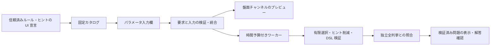

# ルールの UI 要求から構成する Web アプリ

このアプリは、既存の黒白4ルールと3ヒント形式を選び、9セル以下の問題を生成するローカルの実験です。
ルール定義が宣言するパラメータ・盤面チャンネルをサーバーで統合し、ブラウザがその計画から描画します。
任意の Python ルールや異なる盤面型が、そのまま使える仕組みではありません。

## 起動と操作

リポジトリのルートで実行します。アプリの実行に Node.js やフロントエンドのビルドは不要です。

```sh
uv sync --all-packages --group dev --locked
uv run --no-sync python examples/web_server.py
```

表示された `http://127.0.0.1:8765` をブラウザで開きます。終了はターミナルで Ctrl+C です。
生成中の終了は、残りの計算予算とワーカーの回収を待ちます。強制終了に対する回収保証はありません。
ポート変更は `--port 8766`、空きポートを選ぶ場合は `--port 0` を指定し、実際に表示された URL を使います。
`localhost` への読み替えはせず、表示されたホスト・ポートを使ってください。

1. 行・列、seed、計算予算を設定します。行×列は9以下、予算は1〜30秒です。
2. 黒マスの個数、黒の非接触、白の連結、白2×2禁止からルールを選びます。入力欄は各ルールの宣言から生成されます。
3. セル・行数・列数から候補ヒントを選びます。選んだヒントが必要とする表示欄がプレビューに追加されます。
4. 生成すると、唯一解とヒント既約性を検証した問題だけが表示されます。未知マスを押して解答を入力し、確認できます。
5. 必要なときだけ答えを表示し、既存の黒白形式の JSON を保存できます。通常の CLI の `verify` / `show` でも読めます。

固定ヒントは枠線と印で区別し、変更できません。行・列の **0** とヒントなしの **−** は別です。
セルには Tab で移動し、Space または Enter で色を切り替えられます。横長の盤面は盤面内で横スクロールします。
通常表示では答えを隠しますが、返されたデータ・ブラウザメモリ・保存 JSON には答えが含まれます。
ブラウザの採点は、生成時に検証された唯一解との比較です。外部から持ち込んだ任意問題の検証 UI ではありません。

再現例は初期値の2×3、黒2個・白連結、全3ヒント、seed 0です。黒の非接触も追加できます。
2×3で黒6個・非接触を選ぶと矛盾、2×2で黒1個・行数ヒントだけを選ぶとヒント不足になります。
時間切れの結果はマシンに依存するため、同じ秒数で必ず再現するものではありません。

## 宣言型 UI の契約

[`puzzle_defs.ui`](../packages/puzzle-defs/src/puzzle_defs/ui.py) は Web フレームワークに依存しない凍結データクラスです。
[`shading.py`](../packages/puzzle-defs/src/puzzle_defs/puzzles/shading.py) の既存ルールに `ui: ClassVar[RuleUi]`、
行・列ヒントに `ClassVar[ClueUi]` を置きます。セルヒントはタプル型のため同じモジュールの `CLUE_UI` に宣言します。
これらはコンストラクタ引数・保存パラメータではなく、既存の `apply`・解の射影・生成契約を変えません。
カスタムルールに UI 宣言を必須にする Protocol 変更も行いません。

| 宣言 | 内容と責任 |
| --- | --- |
| `RuleUi` | 固定 ID、表示名、説明、パラメータ、必要な UI。説明は制約の証明には使わない |
| `UiParameter` | 名前、表示名、整数／真偽値、初期値、整数の上下限。上限 `area` は盤面面積に解決 |
| `UiRequirements` | トポロジー、名前付きチャンネル、UI のセル数上限 |
| `UiChannel` | 共有チャンネル名と型。`answer/binary-cells`、`givens/cell-givens`、行数、列数 |
| `ClueUi` | ヒント候補の ID と表示名、必要な表示チャンネル |

整数と真偽値は別型です。真偽値を0/1に変換せず、余計なパラメータ・不足値も拒否します。
初期値は UI の初期入力であり、サーバーが不足値を暗黙に埋める規約ではありません。
同じルールの重複選択はこの Web API では拒否します。Python DSL の複数出現の仕様は変えません。

要求の統合は、同一トポロジー、同名チャンネルの型一致、チャンネルの和集合、セル数上限の最小値で行います。
アプリの描画器が持たないチャンネル・トポロジーは拒否します。同名で異なる値域の回答を黙って同一視しません。
この最初の UI プロファイルは9セルまでです。ルールの数学的な適用範囲や Python API の盤面上限ではありません。
UI 適合と数学的成立は別であり、適合する黒6個・非接触の組合せも生成段階で矛盾と判定されます。



## HTTP API と結果

`GET /api/catalog` は `puzzle-box/web-catalog-v1`、`POST /api/plan` は求解しない UI 適合検査、
`POST /api/generate` は生成・検証です。POST は同じ Origin と `application/json`、単一の Content-Length を必要とします。
要求は UTF-8、8,192バイト以下で、重複 JSON キー・非有限数・未知フィールド・未知バージョンを拒否します。
クライアントが宣言する任意の `requirements` やコードは受け入れません。

```json
{
  "format": "puzzle-box/web-request-v1",
  "rows": 2, "cols": 3,
  "rules": [
    {"id": "count", "parameters": {"count": 2}},
    {"id": "connected-white", "parameters": {"nonempty": true}}
  ],
  "clue_kinds": ["cell", "row-count", "column-count"],
  "seed": 0, "budget_seconds": 10
}
```

| `status` | 意味 |
| --- | --- |
| `ok` | 生成時のみ、DSL 検証と独立全列挙で唯一解・既約性を確認した保存問題と描画計画を返す。plan の ok は UI 適合のみ |
| `unsatisfiable` | 全配置（最大512）に対し、既知ルールを満たす完成解が0個と証明した |
| `insufficient_hints` | 完成解はあるが、全候補ヒントでも識別できる完成解が0個と証明した |
| `timeout` | 予算で打切り。解なし・複数解・唯一解のいずれも主張しない |
| `unconfirmed` | 求解・実装・ワーカー応答等で検証未完了。数学的な結論ではない |
| `invalid`（HTTP 400） | 入力・UI 要求・形式が不正または未対応 |
| `busy`（HTTP 409） | 他の生成が実行中。キューには積まない |
| `forbidden`（HTTP 403） | Host・Origin・Content-Type がこのローカル入口と一致しない |

有限選択は既存の `finite_shading` を使い、識別可能な完成解の集合から seed で選びます。
実際のヒント削減と唯一解検証は既存の生成器・DSL に任せ、最終解集合と各ヒント除去後の別解存在を
`analyze_shading` の独立判定と照合します。補助変数の代入を解数に数えません。
有限判定を持たない任意ルールの追加は、この4ルール向けの検証保証をそのまま継承できません。

生成・import・有限判定・検証をひとつのワーカーで処理し、サーバー全体で同時に1件までです。
予算に達したワーカーは終了・回収します。OS のプロセス起動・終了や通信の時間まで厳密に制限するものではなく、
CPU数・メモリの隔離でもありません。接続が切れても処理は予算内で終了します。利用者による途中キャンセルは未対応です。
seed・同じ環境での再現性は確認できますが、異なる solver/Python/OS/コード間の同一出力を保証しません。
唯一解・既約性は、最少ヒント数・人間の難易度・説明推論の完遂を意味しません。

## 安全性と拡張範囲

サーバーは `127.0.0.1` のみで待ち受け、Host と POST Origin を実際の URL に固定します。
CORS を許可せず、静的配信は3つの固定ファイルのみです。要求からパス・Python import・関数・コマンドを受け取りません。
ブラウザは文字列をテキストとして描画し、HTML 注入や外部 CDN を使いません。CSP でスクリプト・接続・埋め込みも制限します。
保存はブラウザで利用者がダウンロードし、サーバーが任意のパスへファイルを書く API はありません。

これは信頼済み同一ユーザーのローカル実験です。Origin/Host 検査は認証ではなく、ローカルの別プログラムはヘッダーを偽装できます。
Python の登録コードは信頼済みであり、サブプロセスを任意コードのサンドボックスとして扱いません。
公開サーバー向けの認証・TLS・永続ジョブ・利用者別リソース分離・負荷対策は実装していません。
[`http.server` の公式説明](https://docs.python.org/3.12/library/http.server.html)も、本番用途を推奨していません。
ワーカーの終了と起動時間の限界は [`subprocess.run` の仕様](https://docs.python.org/3.12/library/subprocess.html#subprocess.run)に従います。

次に広げるときは、宣言の追加だけで済む場合と、描画・生成の実装が必要な場合を分けます。

- 同じ黒白値域・既存入力型のルール: UI 宣言、固定カタログへの明示登録、読書きの codec、独立判定とテストが必要です。JSON だけでは登録できません。
- ループ辺・数字・領域: チャンネルの型、描画・入力器、保存形式、回答射影、ヒント抽出を追加する必要があります。
- 黒白とループの接続: 両チャンネルの併置に加え、共有トポロジーと相互制約を実装します。UI 要求の和集合だけでは数学的結合は生じません。
- 自作ルールの公開: 信頼済み登録と非信頼コード実行を分離した別設計が必要です。既存の Python 部品登録 API を Web にそのまま公開しません。

## テスト

Python の通常テストに UI 要求の衝突・入力境界・HTTP 制限・時間切れとワーカー回収・終了時の回収待ち・保存形式互換性を含みます。
ブラウザテストは Node.js 22 と固定 Playwright を使います。PC の既存ブラウザを操作せず、専用のヘッドレス Chromium を起動します。

```sh
cd apps/web
npm ci --ignore-scripts
npx playwright install chromium
npm test
```

テスト専用サーバーは `127.0.0.1:8792` で起動・終了し、既に使われている場合は失敗します。
5つのブラウザシナリオで実生成、UI チャンネル切替、解答確認、矛盾・ヒント不足、時間切れ表示、狭い画面、
キーボード操作・ホバー時の色・横長盤面のスクロール範囲を検証します。
ブラウザの時間切れ表示は固定応答で検証し、実際のプロセス打切りは Python テストで別に確認します。
CI は既存4環境の Python 検証に加え、Ubuntu の Chromium 1ジョブを実行します。
