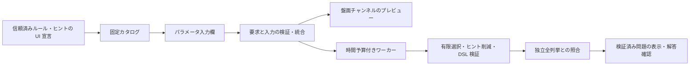

# ルールの UI 要求から構成する Web アプリ

このアプリは、既存の黒白4ルール（9セル以下）、スリザーリンク（4セル以下）、黒白とセル中心ループの固定3条件（9セル以下）から問題を生成するローカルの実験です。
ルール定義が宣言するパラメータ・盤面チャンネルをサーバーで統合し、ブラウザがその計画から描画します。
任意の Python ルールや異なる盤面型が、そのまま使える仕組みではありません。
Vercelで利用する場合は、ローカルHTTPサーバーとは別の[配信手順と計算制限](deploy-vercel.md)に従います。

## 起動と操作

リポジトリのルートで実行します。アプリの実行に Node.js やフロントエンドのビルドは不要です。

```sh
uv sync --all-packages --group dev --locked
uv run --no-sync python examples/web_server.py
```

表示された `http://127.0.0.1:8765` をブラウザで開きます。終了はターミナルで Ctrl+C です。
生成中の終了は、残りの計算予算とワーカーの回収を待ちます。強制終了に対する回収保証はありません。
ポート変更は `--port 8766`、空きポートを選ぶ場合は `--port 0` を指定し、実際に表示された URL を使います。
`localhost` への読み替えはせず、表示されたホスト・ポートを使ってください。

1. 盤面の種類、行・列、seed、計算予算を設定します。予算は1〜30秒です。
2. 黒白では個数・非接触・連結・白2×2禁止、ループでは必須の空でない1本ループと任意の長さ指定を組み合わせます。入力欄は定義側の宣言から生成されます。
3. 黒白ではセル・行数・列数、ループではセルを囲む辺の数・固定辺、複合盤面では黒白・固定辺から候補ヒントを選びます。選んだヒントが必要とする表示欄がプレビューに追加されます。
4. 生成すると、唯一解とヒント既約性を検証した問題だけが表示されます。未知マスを押して解答を入力し、確認できます。
5. 必要なときだけ答えを表示し、既存の黒白／スリザーリンク／ヤジリン形式の JSON を保存できます。対応する CLI の `verify` / `show` でも読めます。

固定ヒントは枠線と印で区別し、変更できません。行・列の **0** とヒントなしの **−** は別です。
セルには Tab で移動し、Space または Enter で色を切り替えられます。横長の盤面は盤面内で横スクロールします。
通常表示では答えを隠しますが、返されたデータ・ブラウザメモリ・保存 JSON には答えが含まれます。
解答確認は、現在のルール・ヒントと全セル／全辺の入力をサーバーに送ります。サーバーは保存された答えを信用せず、
独立判定と DSL で充足性を検証します。通信失敗・時間切れは不正解とは扱いません。外部問題の読込 UI は未対応です。
確認中は設定・盤面・操作ボタンを一時停止しますが、進捗の読み上げ領域は有効に保ち、終了後に確認ボタンへフォーカスを戻します。

スリザーリンクでは辺を押すと未入力（?）→線なし（×）→線ありの順に変わります。Tab と Space/Enter でも入力できます。
セル内の数字は周囲4辺の使用本数で、0も有効なヒントです。「·」は数字なしを表します。
4辺を使うセルも許す既存レシピの仕様に従い、数字の範囲は0〜4です。固定辺は枠線と読み上げ名で区別します。
再現例は2×2・長さ8・両ヒント・seed 2で、数字と固定辺が残ります（固定環境）。長さ5は矛盾、長さ8でヒントなしはヒント不足です。
辺の入力は保存済み答えの辺リストではなく、使用しない辺も含む完全入力です。

「黒白とセル中心ループ」は、黒を上下左右で隣り合わせず、空でない1本のループが白マスすべてを通る構成です。
白には2本、黒には0本の辺がつながります。3条件は必須で、個別解除はできません。
辺は**セルの中心同士**を結び、スリザーリンクの角頂点とは座標の意味が異なります。
セルと辺をそれぞれ押し、両方をすべて入力して確認してください。片方だけでは採点しません。
行数・列数とも2以上、合計9セル以下に限定し、矢印の配置や数ヒントは扱いません。
再現例は3×3・両ヒント・seed 0です。固定環境では右下の黒ヒント1つが残ります。
候補ヒントを選んでも、削減後に両種類が残る保証はありません。3×3でヒントなしはヒント不足、
2×2はヒントなしでも全白・外周ループに決まる退化例です。遊び応えを保証しません。
保存ファイルは `python examples/generate_yajilin.py verify puzzle.json` や `show puzzle.json` で利用できます。

再現例は初期値の2×3、黒2個・白連結、全3ヒント、seed 0です。黒の非接触も追加できます。
2×3で黒6個・非接触を選ぶと矛盾、2×2で黒1個・行数ヒントだけを選ぶとヒント不足になります。
時間切れの結果はマシンに依存するため、同じ秒数で必ず再現するものではありません。

## 宣言型 UI の契約

[`puzzle_defs.ui`](../packages/puzzle-defs/src/puzzle_defs/ui.py) は Web フレームワークに依存しない凍結データクラスです。
[`shading.py`](../packages/puzzle-defs/src/puzzle_defs/puzzles/shading.py) の既存ルールに `ui: ClassVar[RuleUi]`、
行・列ヒントに `ClassVar[ClueUi]` を置きます。セルヒントはタプル型のため同じモジュールの `CLUE_UI` に宣言します。
これらはコンストラクタ引数・保存パラメータではなく、既存の `apply`・解の射影・生成契約を変えません。
カスタムルールに UI 宣言を必須にする Protocol 変更も行いません。
[`SlitherlinkRecipe`](../packages/puzzle-defs/src/puzzle_defs/puzzles/slitherlink_recipe.py) は既存の必須ループと任意の長さ制約を
`rule_ui` に宣言し、数字・固定辺のヒントクラスも `ui` を持ちます。生成器の制約自体は変更しません。
[`YajilinRecipe`](../packages/puzzle-defs/src/puzzle_defs/puzzles/yajilin_recipe.py) は、矢印なしのWebプロファイル向けに
必須3条件と2種類のヒントを宣言します。Pythonレシピの矢印対応やコンストラクタは変えません。
共有する `EdgeStateClue` の角頂点向け宣言を流用せず、このレシピの `clue_ui` に中心辺の要求を置きます。

| 宣言 | 内容と責任 |
| --- | --- |
| `RuleUi` | 固定 ID、表示名、説明、パラメータ、必要な UI、選択必須かどうか。説明は制約の証明には使わない |
| `UiParameter` | 名前、表示名、整数／真偽値、初期値、整数の上下限。上限 `area` はセル数、`edges` は格子辺数に解決 |
| `UiRequirements` | トポロジー、名前付きチャンネル、UIのセル数上限、行・列の下限（既定1） |
| `UiChannel` | 共有チャンネル名と型。黒白の `answer/binary-cells`、ループの `answer/binary-edges` など |
| `ClueUi` | ヒント候補の ID と表示名、必要な表示チャンネル |

整数と真偽値は別型です。真偽値を0/1に変換せず、余計なパラメータ・不足値も拒否します。
初期値は UI の初期入力であり、サーバーが不足値を暗黙に埋める規約ではありません。
同じルールの重複選択はこの Web API では拒否します。Python DSL の複数出現の仕様は変えません。

要求の統合は、同一トポロジー、同名チャンネルの型一致、チャンネルの和集合、セル数上限の最小値、行・列下限の最大値で行います。
下限の積がセル数上限を超える要求も拒否します。対応トポロジーは信頼済みの呼出し側が指定し、リクエストからは受け取りません。
アプリの描画器が持たないチャンネル・トポロジーは拒否します。同名で異なる値域の回答を黙って同一視しません。
黒白・複合盤面は9セル、スリザーリンクは4セルまでです。ルールの数学的な適用範囲や Python API の盤面上限ではありません。
UI 適合と数学的成立は別であり、適合する黒6個・非接触の組合せも生成段階で矛盾と判定されます。

両者は矩形のセルと角頂点という同じトポロジーを使いますが、`answer` の値域が違います。
黒白と辺を同じ回答として統合すると型衝突になるため拒否します。Web の固定カタログもプロファイル別で、他方のルール・ヒント ID を受け付けません。
ループの表示には `cell-counts/cell-edge-counts` と `edge-givens/edge-givens` を合成します。
複合プロファイルは別の `rectangular-cell-centers` トポロジーに、`answer-cells/binary-cells` と
`answer-edges/binary-edges` を併置します。固定ヒントは `givens/cell-givens` と `edge-givens/edge-givens` です。
ブラウザは既存のセル・辺ボタンを、中心同士を結ぶ専用配置に合成します。相互制約は既存のヤジリンDSLが定義します。
3プロファイルは要求検査・フォーム・HTTP境界を共有しますが、任意に異なるプロファイルのルールを混ぜるAPIではありません。



## HTTP API と結果

`GET /api/catalog` は `puzzle-box/web-catalog-v1`、`POST /api/plan` は求解しない UI 適合検査、
`POST /api/generate` は生成・検証です。POST は同じ Origin と `application/json`、単一の Content-Length を必要とします。
カタログの既存黒白フィールドは維持し、`profiles` に3種類の宣言を含めます。
従来の `web-request-v1` は黒白専用のまま利用できます。新UIは `web-request-v2` に `family: "shading" | "slitherlink" | "coupled"` を指定し、
v2の描画計画を受け取ります。v1に `family` を足すことや、未知バージョンは拒否します。
要求は UTF-8、8,192バイト以下で、重複 JSON キー・非有限数・未知フィールド・未知バージョンを拒否します。
POST本文は応答前に上限付きで受信し、Host・Origin検査を通った要求だけをJSONとして解析します。
超過検出の受信も8,193バイトまでで、各ソケット読み取りには3秒のタイムアウトがあります。
不正な本文長・転送形式や通信切断では、JSON応答を受け取れず接続終了になる場合があります。
クライアントが宣言する任意の `requirements` やコードは受け入れません。

```json
{
  "format": "puzzle-box/web-request-v1",
  "rows": 2, "cols": 3,
  "rules": [
    {"id": "count", "parameters": {"count": 2}},
    {"id": "connected-white", "parameters": {"nonempty": true}}
  ],
  "clue_kinds": ["cell", "row-count", "column-count"],
  "seed": 0, "budget_seconds": 10
}
```

| `status` | 意味 |
| --- | --- |
| `ok` | 生成時のみ、DSL 検証と独立全列挙で唯一解・既約性を確認した保存問題と描画計画を返す。plan の ok は UI 適合のみ |
| `unsatisfiable` | 有限範囲で既知ルールを満たす完成解が0個と証明した。黒白は最大512配置、スリザーリンクは最大8,192辺配置、複合は最大4,096辺配置から色を決定 |
| `insufficient_hints` | 完成解はあるが、全候補ヒントでも識別できる完成解が0個と証明した |
| `timeout` | 予算で打切り。解なし・複数解・唯一解のいずれも主張しない |
| `unconfirmed` | 求解・実装・ワーカー応答等で検証未完了。数学的な結論ではない |
| `invalid`（HTTP 400） | 入力・UI 要求・形式が不正または未対応 |
| `busy`（HTTP 409） | 他の生成が実行中。キューには積まない |
| `forbidden`（HTTP 403） | Host・Origin・Content-Type がこのローカル入口と一致しない |

有限選択は既存の `finite_shading` を使い、識別可能な完成解の集合から seed で選びます。
実際のヒント削減と唯一解検証は既存の生成器・DSL に任せ、最終解集合と各ヒント除去後の別解存在を
`analyze_shading` の独立判定と照合します。補助変数の代入を解数に数えません。
有限判定を持たない任意ルールの追加は、この4ルール向けの検証保証をそのまま継承できません。

ループは最大13辺の全配置を列挙し、次数0/2・非空・連結性と長さを独立判定します。
全候補ヒントで区別できる完成形をseedで選び、DSLで確認して既存のヒント削減を使い、最後に唯一解と既約性を全列挙と照合します。
数ヒントだけで区別できない完成形は選びません。どの完成形も識別できない場合だけ `insufficient_hints` です。
全候補ヒントの曖昧さを隠して固定辺を勝手に追加することはありません。

複合盤面は最大12本の中心辺を列挙し、1本のループが通らないセルを黒に定めて非接触を検査します。
「すべての白を通り、黒を通らない」という必須条件によって色が定まるため、色と辺の直積全列挙は不要です。
3×3では5通りの組が残ります。初期・削減後のヒントで色と線を合わせた唯一解をDSLと独立列挙で照合します。
この最適化を、白の通過条件を解除した組合せや矢印のある盤面に一般化してはいけません。

`POST /api/check` は `format: "puzzle-box/web-answer-v1"` と `request`・`clues`・`answer` を持つオブジェクトを受け取ります。
`request` は生成に用いた要求、`clues` は表示された型付きヒント、`answer` は全セル／全辺の0/1配列です。
黒白は行順、ループは横辺を上から行順に並べた後、縦辺を上から行順に並べます。ループ生成応答の `edges` が対応する座標順を示します。
複合盤面だけは `format: "puzzle-box/web-answer-v2"`、`answer: {"cells": [...], "edges": [...]}` を使います。
`cells` は行順の全セル（黒1・白0）、`edges` は全中心辺（線あり1・なし0）。生成応答の `cells` / `edges` が座標順です。
両配列が必要で、3×3なら9セルと12辺です。旧配列形式・片方の省略・未知の追加フィールドを拒否します。
既存2プロファイルの回答v1は変更せず、そちらへの回答v2送信も拒否します。
正しく検査できたときは `{"status":"ok","correct":true}` または `false`、未確定なら `timeout` / `unconfirmed` を返します。
採点は**送信された**ルール・ヒントに対する充足性です。任意のクライアントが送信内容を変更でき、元の出題の真正性や一意性を認証するAPIではありません。
ヒントの種類・数・座標・重複と入力長・型を検査し、生成と同じワーカー予算・同時1件の制限を使います。

生成・import・有限判定・検証をひとつのワーカーで処理し、サーバー全体で同時に1件までです。
予算に達したワーカーは終了・回収します。OS のプロセス起動・終了や通信の時間まで厳密に制限するものではなく、
CPU数・メモリの隔離でもありません。接続が切れても処理は予算内で終了します。利用者による途中キャンセルは未対応です。
seed・同じ環境での再現性は確認できますが、異なる solver/Python/OS/コード間の同一出力を保証しません。
唯一解・既約性は、最少ヒント数・人間の難易度・説明推論の完遂を意味しません。

## 安全性と拡張範囲

サーバーは `127.0.0.1` のみで待ち受け、Host と POST Origin を実際の URL に固定します。
CORS を許可せず、静的配信は3つの固定ファイルのみです。要求からパス・Python import・関数・コマンドを受け取りません。
ブラウザは文字列をテキストとして描画し、HTML 注入や外部 CDN を使いません。CSP でスクリプト・接続・埋め込みも制限します。
保存はブラウザで利用者がダウンロードし、サーバーが任意のパスへファイルを書く API はありません。

これは信頼済み同一ユーザーのローカル実験です。Origin/Host 検査は認証ではなく、ローカルの別プログラムはヘッダーを偽装できます。
Python の登録コードは信頼済みであり、サブプロセスを任意コードのサンドボックスとして扱いません。
公開サーバー向けの認証・TLS・永続ジョブ・利用者別リソース分離・負荷対策は実装していません。
[`http.server` の公式説明](https://docs.python.org/3.12/library/http.server.html)も、本番用途を推奨していません。
ワーカーの終了と起動時間の限界は [`subprocess.run` の仕様](https://docs.python.org/3.12/library/subprocess.html#subprocess.run)に従います。

次に広げるときは、宣言の追加だけで済む場合と、描画・生成の実装が必要な場合を分けます。

- 同じ黒白値域・既存入力型のルール: UI 宣言、固定カタログへの明示登録、読書きの codec、独立判定とテストが必要です。JSON だけでは登録できません。
- その他の辺ルール・数字・領域: 今回の型と一致しない場合は、チャンネルの型、描画・入力器、保存形式、回答射影、ヒント抽出を追加する必要があります。
- その他の黒白とループの接続: 今回の中心ループ3条件以外には、共有トポロジー・相互制約・有限判定の追加が必要です。UI 要求の和集合だけでは数学的結合は生じません。
- 自作ルールの公開: 信頼済み登録と非信頼コード実行を分離した別設計が必要です。既存の Python 部品登録 API を Web にそのまま公開しません。

## テスト

Python の通常テストに UI 要求の衝突・入力境界・HTTP 制限・時間切れとワーカー回収・終了時の回収待ち・保存形式互換性を含みます。
ブラウザテストは Node.js 22 と固定 Playwright を使います。PC の既存ブラウザを操作せず、専用のヘッドレス Chromium を起動します。

```sh
cd apps/web
npm ci --ignore-scripts
npx playwright install chromium
npm test
```

テスト専用サーバーは `127.0.0.1:8792` で起動・終了し、既に使われている場合は失敗します。
ブラウザシナリオで実生成、UI チャンネル切替、サーバー解答確認、矛盾・ヒント不足、時間切れ表示、狭い画面、
キーボード操作・ホバー時の色・横長盤面のスクロール範囲を検証します。
ブラウザの時間切れ表示は固定応答で検証し、実際のプロセス打切りは Python テストで別に確認します。
CI は既存4環境の Python 検証に加え、Ubuntu の Chromium 1ジョブを実行します。
ループの独立テストは、4セル以下の格子で辺の全列挙と連結したセル集合の境界を比較します。
この範囲では穴ができません。より大きい盤面の列挙性能や一般の位相を証明する検査ではありません。
複合盤面は対応6形状（2×2、2×3、3×2、2×4、4×2、3×3）で、辺部分集合の列挙を、連結面集合の境界と全黒白配置による別列挙、
およびDSLの黒白と辺を合わせた全解と照合します。色または線だけを変えた不正解、保存形式、ヒント削減後の唯一性も検査します。
